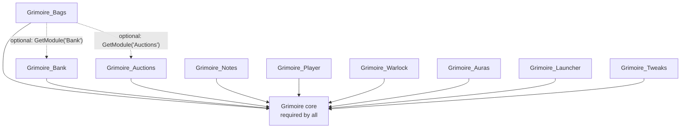

# ADR 0002: Every component is a separately toggleable add-on

- **Status:** Accepted
- **Date:** 2026-10-13

## Context

Grimoire is meant to replace many third-party add-ons over time. While a component is new, being able to switch it off is the safety net. If the new bags misbehave, you turn off `Grimoire_Bags` and use Blizzard's bags or an old add-on until it's fixed, without losing the rest of the suite.

WoW's in-game AddOns list shows one checkbox per add-on folder (one `.toc`). So the unit you can toggle there is the add-on, not a module inside one.

## Decision

1. **One component = one add-on folder** named `Grimoire_<Component>`, with its own `.toc`. Examples: `Grimoire_Bags`, `Grimoire_Bank`, `Grimoire_Auctions`, `Grimoire_Notes`, `Grimoire_Warlock`.
2. **Components depend only on core.** A component's `.toc` lists `## RequiredDeps: Grimoire` and nothing else. A component never requires another component.
3. **Integration is optional and late-bound.** When one component uses another (e.g. the Bags window's *Bank* button), it looks it up at runtime with `Grimoire:GetModule(name)` and checks `IsEnabled()`, or listens to core callbacks. If the other component is off, the feature hides or degrades quietly.
4. **Shared code goes into core**, not into a component that others then need. Examples: container reading, windows, display slots.
5. **Group in the AddOns list.** Every `.toc` carries `## Group: Grimoire` and `## Category: Grimoire` so the components sit together. (Supported on recent Mainline clients; older clients ignore unknown fields. Still to be verified on Forever.)
6. **Within a component**, individual modules can still be toggled without a reload via `/grimoire enable|disable <module>`.

## Consequences

- Any component can be turned off in the AddOns list, and the rest keep working.
- More folders and `.toc` files to maintain. `scripts/link-addons.ps1` and `.pkgmeta` must list each one. The link script picks up `Grimoire*` folders automatically.
- Core grows into a shared toolkit, so it needs to stay generic and must not collect feature logic.
- Saved data stays in the single `GrimoireDB` owned by core, so turning a component off never deletes its data.

## Alternatives considered

- **One big add-on with internal toggles only:** simpler to package, but a broken feature would mean disabling everything or relying on a slash command, and an in-game settings toggle can't stop code that errors while loading.
- **Fully independent add-ons, no shared core:** maximum isolation, but every component would repeat the database, windows and combat handling.
