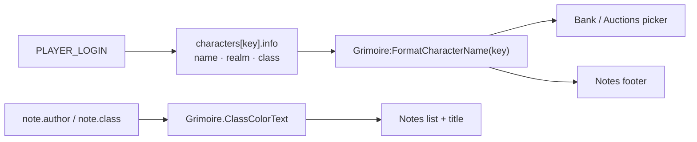

# ADR 0003: Show which character owns data, in class colors

- **Status:** Accepted
- **Date:** 2026-10-13

## Context

Grimoire stores data per character but shares it across the account: bank snapshots, auctions, notes, and more to come. Once you can browse another character's bank or auctions, it has to be obvious *whose* data is on screen. Otherwise it's easy to believe your Warlock has the Runecloth that's actually on your Mage.

WoW already has a convention for "who": class colors. Warlocks are purple, Mages light blue, Rogues yellow, and so on, in chat, raid frames, guild lists and tooltips.

## Decision

1. **Name the character.** Wherever a view shows data that belongs to a specific character, it names that character. Examples: a character picker on the Bank and Auctions viewers, and the author on notes.
2. **Use class colors for character-related text.** Character names, and text that a character authored (e.g. a note's title), are shown in that character's class color.
3. **Blizzard's colors, via core helpers.** Use `Grimoire.ClassColorText`, `Grimoire.GetClassColor` and `Grimoire:FormatCharacterName`. They use `C_ClassColor` / `RAID_CLASS_COLORS`, so colors match the rest of the game ([ADR 0001](0001-prefer-classic-style-ui.md)) and respect any class-color overrides.
4. **Realm only when needed.** Show "Name" for characters on the current realm and "Name - Realm" otherwise.
5. **Current character first.** Character lists start with the character you're logged in on, then the rest alphabetically. Views open on the current character.
6. **"Live" applies to the current character only.** A view shows a live indicator only for the character being played. Other characters' data always shows its age ("Updated 3d ago").
7. **Record who.** Core records each character's name, realm and class at login (`GrimoireDB.global.characters[key].info`). Components that create data save the author's key and class with it, so the color stays correct even if that character is never logged in again.
8. **Fallback.** Older data or unknown characters show uncolored text and never error.

## "Where relevant"

This applies where the data could belong to more than one character. Live views of the current character's own state (bags, the Warlock bar) don't need a name, because they're always yours.

## Consequences

- Every new account-wide feature should store a character key, and the class where useful, with its records.
- Character pickers come from one shared widget (`Grimoire.CreateCharacterPicker`) for consistency.
- Notes written before this change have no author. They stay uncolored and show no "by" line.

## Alternatives considered

- **Show the name only, without color:** less recognisable at a glance, and it breaks WoW's own convention.
- **Hand-picked palette:** would clash with class colors everywhere else in the game.
