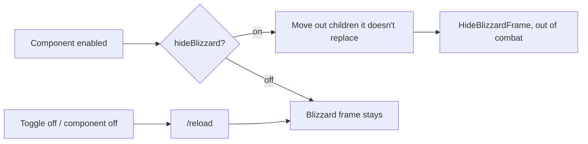

# ADR 0004: Components replace the Blizzard UI they duplicate

- **Status:** Accepted
- **Date:** 2026-10-13

## Context

Phil's long-term goal is to turn off Blizzard's UI entirely, with Grimoire drawing everything. Each component that takes over a piece of the default UI (player frame, buffs, later target frame, action bars, micro menu) needs a consistent answer to three questions: is Blizzard's version hidden, can you get it back, and how?

Hiding Blizzard frames has costs. Protected frames can only be changed out of combat. Some frames have children another part of the UI still needs (the Classic pet frame is a child of the player frame). And hiding can't be cleanly undone mid-session, because Blizzard's code has already been cut off from its events.

## Decision

1. **Hidden by default.** A component that replaces a Blizzard frame hides it when the component is enabled, using `Grimoire:HideBlizzardFrame(frame)` (reparent to a hidden frame, events off, out of combat).
2. **A per-component toggle.** Each one offers a `hideBlizzard` setting ("Hide Blizzard …") in its menu, on by default and marked `reload = true`.
3. **`/reload` restores.** Turning the toggle or the component off takes effect after a `/reload`; there's no mid-session un-hiding.
4. **Rescue what else lives inside.** Before hiding, a component moves out any child frame it doesn't replace, so nothing else disappears with it (e.g. `PetFrame` from `PlayerFrame`).
5. **Reuse instead of replace when replacing would lose function.** If Grimoire can't match a Blizzard frame (secure behaviour the client doesn't expose), it moves and restyles Blizzard's frame instead of hiding it. Example: Auras moves `BuffFrame`, because Forever has no `SecureAuraHeaderTemplate`.

## Consequences

- Turning off a component (ADR 0002) plus a `/reload` always gets you the default UI back. That's the safety net while components are new.
- Each replacement must handle the children and side effects of the frame it hides. These are listed in its feature doc.
- Menus and other entry points that live on hidden frames (micro menu, player menu) must stay reachable. Grimoire's own frames call the same Blizzard functions.

## Alternatives considered

- **Leave Blizzard's frames and add Grimoire's beside them:** no risk, but duplicated UI and no path to replacing it.
- **Hide everything at once from core:** simpler, but a broken component would leave you with no UI for that piece and no per-component way back.
- **Un-hide live, without a reload:** would need to re-register every event and re-run Blizzard's set-up code, which isn't reliable from add-on code.
