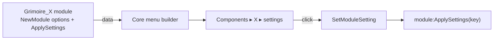

# ADR 0005: Modules describe their settings; core builds the menu

- **Status:** Accepted
- **Date:** 2026-10-13

## Context

Every component has settings (bar width, aura rows, bag columns, ...). Until now they could only be changed by editing SavedVariables. Phil wants to manage everything from inside the game, through one menu.

Components are separate add-ons that depend only on core ([ADR 0002](0002-every-component-is-a-toggleable-addon.md)). So the menu can't know about any of them ahead of time, and a component can't add to another component's UI.

## Decision

1. **Modules declare their settings as data.** `Grimoire:NewModule(name, { addon, label, options })`:
   - `addon`: the add-on folder the module ships in (`local ADDON_NAME = ...`).
   - `label`: the display name.
   - `options`: a list of `{ type = "toggle", key, label }` or `{ type = "choice", key, label, values = { {value, label}, ... } }`, either with an optional `reload = true`.
2. **Only toggles and preset choices.** No free-form input. Everything fits in a dropdown menu on both of Blizzard's menu systems.
3. **Core builds the menu** (`Grimoire:GetMainMenu`, `Core/Menu.lua`) from the installed add-ons (`C_AddOns`) and the registered modules. A component adds nothing to the menu code.
4. **Core changes the value; the module applies it.** `Grimoire:SetModuleSetting(module, key, value)` writes `module.db[key]` and calls `module:ApplySettings(key)`. A module that can't apply a change live marks the option `reload = true`.
5. **Frames are registered through the module** (`Module:RegisterMover`, `CreateWindow(key, title, owner)`), so the menu can offer each module's position, dimming and grouping options.

## Consequences

- A new component gets a menu entry, an Enabled toggle and position options with no menu changes. Adding a setting is one line plus code in `ApplySettings`.
- Settings that need sliders, colours or text can't be offered yet. A future ADR can add option types; the menu falls back to ignoring types it doesn't know.
- Each module must handle `ApplySettings` for every key it declares. Missing it means the value saves but only shows after a `/reload`.

## Alternatives considered

- **Blizzard Settings panel (Interface Options).** Supports sliders and text, but Forever's Settings API is unverified, it's several clicks deep, and it can't show add-ons that failed to load.
- **Each component builds its own menu section.** More flexible, but every component would repeat the same menu code, and the look would drift.
- **Ace3 AceConfig.** Declarative and capable, but adds a dependency and doesn't match the dropdown style Phil chose.
