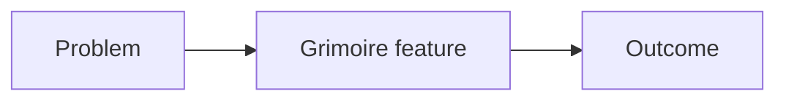

# <Feature name>

- **Add-on:** `Grimoire_<Name>`
- **Module(s):** `<ModuleName>`
- **Status:** Planned | Scaffolded | Tested | Released
- **Replaces:** <third-party add-ons this makes unnecessary>

## Summary

One paragraph: what it is and who it's for.

## What it solves

What's missing or painful in the default UI, plus a diagram.

## How it works

Events in, widgets out. A diagram is preferred.

## Code highlights

Short excerpts with links to the source (`Grimoire_<Name>/File.lua`). Explain *why*, not just *what*.

## Design decisions

Trade-offs, and any exceptions to [ADR 0001](../../adr/0001-prefer-classic-style-ui.md) (classic look) or [ADR 0003](../../adr/0003-show-character-and-class-color.md) (character names and class colors).

## Combat & secret-value constraints

What changes in combat and how the feature degrades.

## Settings

| Key | Default | Description |
| --- | --- | --- |

## Screenshots

_Add to `screenshots/` and embed here._

## Open questions / roadmap
