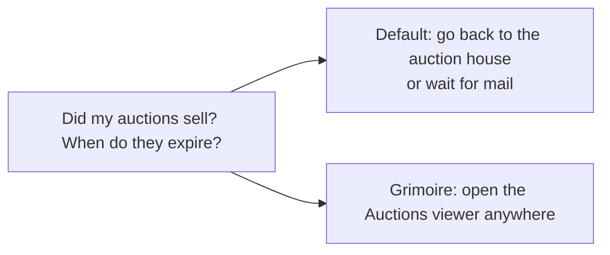
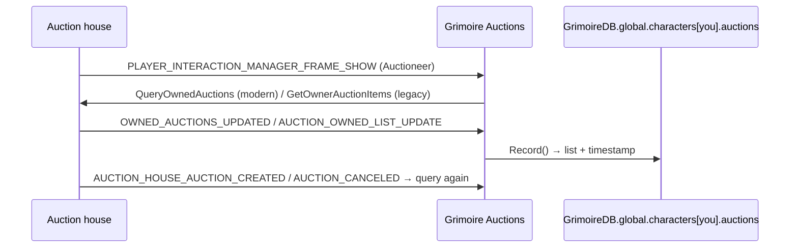
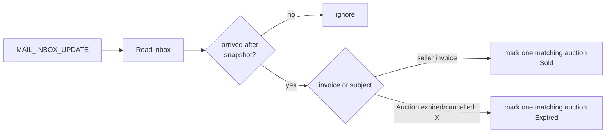

# Auctions

- **Add-on:** `Grimoire_Auctions`
- **Module:** `Auctions`
- **Status:** Scaffolded, untested in game
- **Opened from:** the *Auctions* button in [Bags](../bags/README.md), or `/grimoire auctions`

## Summary

See your active auctions, on any of your characters, from anywhere: what's listed, price, time left, and what's sold. Each time you visit an auctioneer, Grimoire saves that character's auction list. A class-colored character picker switches between characters ([ADR 0003](../../adr/0003-show-character-and-class-color.md)).

## What it solves



## How it works



## Code highlights

**Two auction APIs** ([`Auctions.lua`](../../../Grimoire_Auctions/Auctions.lua)). The Mainline client has `C_AuctionHouse`, and the classic-style owner list may exist instead. Both are supported, and only events this client knows are registered:

```lua
local list = HasModernAPI() and ReadModern(now) or ReadLegacy()
```

**Time left keeps counting while you're away.** The modern API gives seconds remaining, stored as an absolute expiry:

```lua
expiresAt = info.timeLeftSeconds and (now + info.timeLeftSeconds)
-- later: SecondsToTime(auction.expiresAt - time(), true) or "Expired"
```

The legacy API only gives buckets (Short/Medium/Long/Very Long), which are shown as-is.

**Mail tracking is idempotent.** The inbox is re-read on every update, so for each item name the code only tops up to the number of matching mails, and marks are never removed. Mail that arrived before the snapshot is ignored. Arrival is estimated as `now + daysLeft − 30 days`.

```lua
if auction.name == itemName and not auction.mailOutcome and not auction.sold then
    auction.mailOutcome = outcome
```



## Design decisions

- **Character picker.** It opens on the current character and lists every character with saved auctions. "Live" shows only for the character you're playing.
- **Listed value** totals unsold auctions (buyout, or bid if no buyout).
- **A snapshot, updated from your mail.** Opening the mailbox marks auctions as *Sold* (sale invoices, including pending ones) or *Expired* (expired/cancelled mail) without revisiting the auction house.

## Combat & secret-value constraints

None expected.

## Screenshots

_TODO: never visited, mixed active/sold, expired._

## Open questions / roadmap

- Verify which API Forever exposes and that `Enum.PlayerInteractionType.Auctioneer` fires.
- Verify the mail matching on Forever: invoice types, subject strings, and the 30-day mail lifetime.
