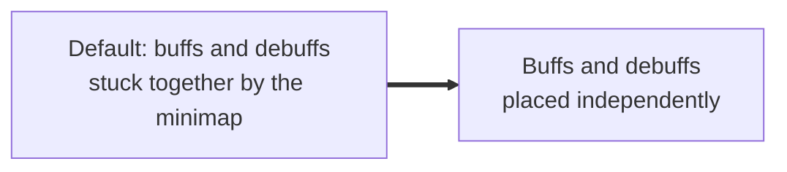
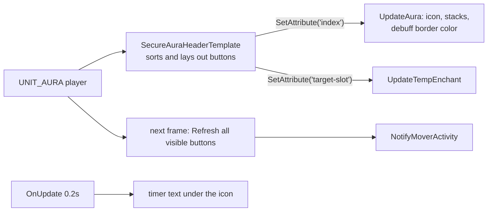

# Auras

- **Add-on:** `Grimoire_Auras`
- **Modules:** `Buffs`, `Debuffs`
- **Status:** Scaffolded, untested in game
- **Replaces:** The default buff frame; buff-mover add-ons

## Summary

Your buffs and your debuffs as two separate frames, each movable, groupable and dimmable on its own. Weapon enchants (Firestone, Spellstone, poisons) show with the buffs. Right-click a buff to cancel it, in or out of combat.

## What it solves



## How it works



## Code highlights

**Blizzard's secure aura header** ([`Auras.lua`](../../../Grimoire_Auras/Auras.lua)). It creates and arranges the buttons in secure code, which is what lets right-click-to-cancel work in combat. Grimoire only draws the visuals:

```lua
local header = CreateFrame("Frame", ..., holder, "SecureAuraHeaderTemplate")
header:SetAttribute("filter", self.filter)            -- HELPFUL or HARMFUL
header:SetAttribute("template", "GrimoireAuraButtonTemplate")
```

**Right-click cancel** comes from the button template ([`Templates.xml`](../../../Grimoire_Auras/Templates.xml)): `type2 = cancelaura`.

**The mover is a plain holder frame** with the secure header anchored to it, so the overlay has a fixed size even when you have no buffs.

## Design decisions

- **Classic look** ([ADR 0001](../../adr/0001-prefer-classic-style-ui.md)): 30px icons, duration text under the icon (`SecondsToTimeAbbrev`), the classic debuff border colored by type.
- **The default buff frame is hidden** as soon as either module is on. On Classic it holds buffs *and* debuffs, so it can't be hidden by halves: with only `Buffs` enabled you'll see no debuffs. Disabling both and `/reload` brings it back.
- **Dim when idle is off by default** here; turn it on per frame in move mode.

## Combat & secret-value constraints

- The headers are protected: they're created, shown and moved only out of combat. Enabling in combat waits until combat ends.
- A group that contains Buffs or Debuffs can't be dragged in combat.
- Secret durations show no timer.

## Settings

Stored in `GrimoireDB.profiles[<profile>].modules.Buffs` / `.Debuffs`. In the menu: **Components ▸ Auras ▸ Buffs / Debuffs**. Changes apply live: `ApplySettings` updates the header's `wrapAfter` / `maxWraps` attributes and the holder size, deferred with `RunOutOfCombat` because the header is protected.

| Key | Default | Menu choices | Description |
| --- | --- | --- | --- |
| `perRow` | 16 | 8 / 12 / 16 / 20 | Icons per row |
| `rows` | 2 (Buffs), 1 (Debuffs) | 1 / 2 / 3 | Maximum rows |

## Screenshots

_TODO: add to `screenshots/`. Suggested: buffs and debuffs apart, weapon enchant, debuff borders, move mode._

## Open questions / roadmap

- Verify in game: `SecureAuraHeaderTemplate` and `cancelaura` on Forever, weapon enchants (`weaponTemplate` / `target-slot`), debuff border texture.
- Optional cooldown spiral instead of the text timer.
