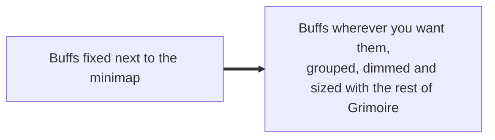
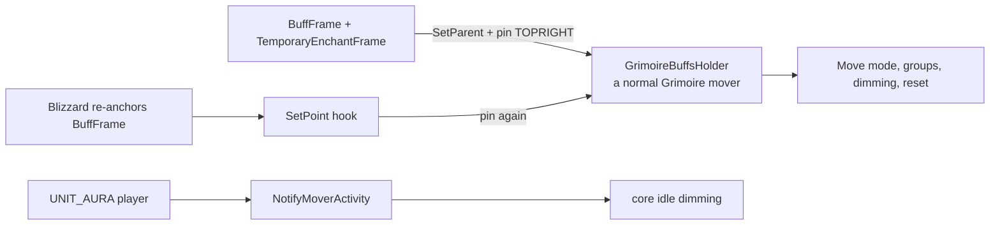

# Auras

- **Add-on:** `Grimoire_Auras`
- **Modules:** `Buffs` (and `Debuffs` on clients with a separate debuff frame)
- **Status:** Scaffolded, untested in game
- **Replaces:** Buff-mover add-ons

## Summary

Blizzard's own buff frame, made into a Grimoire frame: drag it, group it with other frames, dim it when idle, and pick its size from the menu. Because the buttons are still Blizzard's, everything about them works as before: right-click to cancel, weapon enchants (Firestone, Spellstone, poisons), tooltips and timers.

## What it solves



## How it works



On Classic, debuffs are laid out inside `BuffFrame` under the buffs, so they move with **Buffs** (labelled "Buffs and debuffs"). On clients with a separate `DebuffFrame`, **Debuffs** is its own mover; otherwise the menu shows it as unavailable ("debuffs move with Buffs on this client").

## Code highlights

**Reparent and pin** ([`Auras.lua`](../../../Grimoire_Auras/Auras.lua)). Making the holder the parent means the Blizzard frame follows the holder's position and the alpha core sets for dimming:

```lua
frame:SetParent(self.holder)
frame:ClearAllPoints()
frame:SetPoint("TOPRIGHT", self.holder, "TOPRIGHT")
```

**Stay pinned.** Blizzard re-anchors its frames now and then. A `hooksecurefunc` on `SetPoint` puts the frame back unless it's already anchored to the holder:

```lua
hooksecurefunc(frame, "SetPoint", function(f, _, relativeTo)
    if self:IsEnabled() and relativeTo ~= self.holder then
        self:Pin(f)
    end
end)
```

**Size goes on Blizzard's frames, not the holder.** Mover positions are saved in the holder's own units, so scaling the holder would move it.

## Design decisions

- **Reuse Blizzard's buttons instead of drawing our own** (your call, 2026-10-13). The first version used `SecureAuraHeaderTemplate`, but Forever doesn't have it ("Couldn't find inherited node"). Without it, our own buttons would lose right-click-to-cancel in combat. Moving Blizzard's frame keeps that.
- **What we gave up:** separate buff and debuff frames on Classic, and icons per row / rows settings. Blizzard decides the layout.
- **Dim when idle is off by default**; turn it on in the menu or in move mode.
- **Classic look** ([ADR 0001](../../adr/0001-prefer-classic-style-ui.md)) comes for free: they're Blizzard's frames.

## Combat & secret-value constraints

`BuffFrame` isn't protected, so it can be moved and grouped in combat. Blizzard's buttons handle secret values themselves.

## Settings

Stored in `GrimoireDB.profiles[<profile>].modules.Buffs` / `.Debuffs`. In the menu: **Components ▸ Auras**.

| Key | Default | Menu choices | Description |
| --- | --- | --- | --- |
| `scale` | 1 | Small 0.8 / Normal 1 / Large 1.2 / Huge 1.4 | Size of the Blizzard frames (applies live) |

Turning a module off hides its holder (and the buffs with it); `/reload` puts the default buff frame back in its place.

## Screenshots

_TODO: add to `screenshots/`. Suggested: buffs moved under the player bars, grouped in move mode, a weapon enchant._

## Open questions / roadmap

- Verify in game: the holder's size matches the real buff area (it's estimated from `BUFFS_PER_ROW`), and the frames stay pinned after zoning and after weapon enchants come and go.
- Does Forever have a separate `DebuffFrame`?
- If Blizzard's anchoring fights the pin (flicker), switch to hooking `BuffFrame_UpdateAllBuffAnchors` instead.
