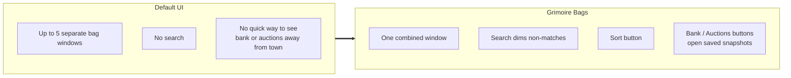
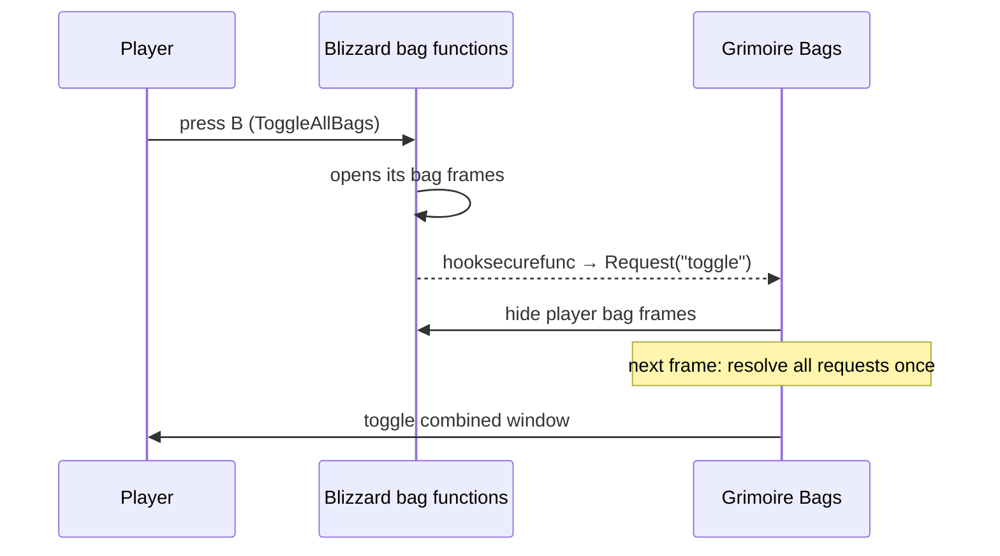
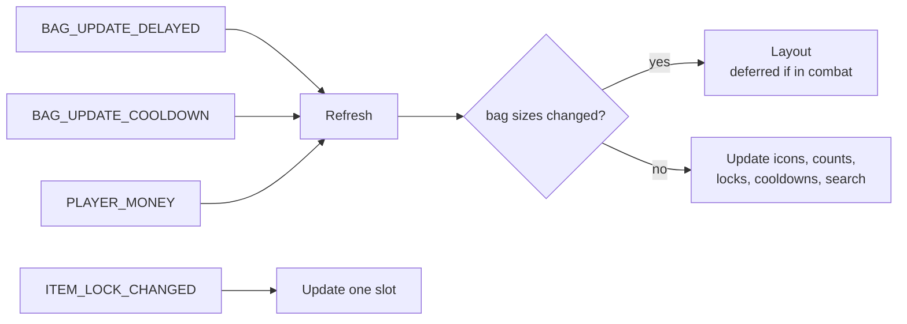

# Bags

- **Add-on:** `Grimoire_Bags`
- **Module:** `Bags`
- **Status:** Scaffolded, untested in game
- **Replaces:** Bagnon / Baganator / AdiBags / ArkInventory (declared as conflicts)
- **Related:** [Bank](../bank/README.md), [Auctions](../auctions/README.md) (separate, optional add-ons)

## Summary

All your bags in one classic-style window. Items work exactly as in Blizzard's bags (right-click to use, drag to move, shift-click to link). The window adds search, a Sort button, free-slot count, your gold, and buttons to open the Bank and Auctions viewers.

## What it solves



## How it works





## Code highlights

**Usable item buttons without custom secure code** ([`Bags.lua`](../../../Grimoire_Bags/Bags.lua)). Each bag gets a holder frame whose ID is the bag; each button's ID is its slot. Blizzard's `ContainerFrameItemButtonTemplate` reads those IDs, so using and moving items goes through Blizzard's own code:

```lua
holder:SetID(bag)
button = CreateFrame("ItemButton", name, holder, "ContainerFrameItemButtonTemplate")
button:SetID(slot)
```

**Hook, don't replace.** Overwriting `ToggleAllBags` would taint it. Hooks are collected and resolved once on the next frame, because one key press can trigger several bag functions:

```lua
if pending ~= "toggle" then
    pending = action -- a toggle (the key press) wins over open/close
end
```

**Bank bags are left alone.** Only frames for player bags are hidden, so the Blizzard bank still works:

```lua
if frame and frame:IsShown() and Grimoire.IsPlayerBag(frame:GetID()) then frame:Hide() end
```

**Optional components ([ADR 0002](../../adr/0002-every-component-is-a-toggleable-addon.md)).** The Bank and Auctions buttons appear only when those add-ons are enabled:

```lua
local module = Grimoire:GetModule("Bank")
button:SetShown(module and module:IsEnabled())
```

## Design decisions

- **Sort uses Blizzard's `C_Container.SortBags()`.** It physically rearranges items. The button disables itself if the client lacks the API.
- **Search dims rather than hides.** Slots stay in place, so muscle memory keeps working.
- **Classic art ([ADR 0001](../../adr/0001-prefer-classic-style-ui.md)):** dialog border, header, empty-slot texture, quality borders, Blizzard bag sounds.

## Combat & secret-value constraints

- Creating or moving item buttons is blocked in combat. If a bag is swapped in combat, the layout change waits until combat ends. Items and counts still update.
- Item cooldowns may be secret in combat, in which case they go straight to the cooldown widget.

## Settings

| Key | Default | Description |
| --- | --- | --- |
| `columns` | 10 | Slots per row |

## Screenshots

_TODO: closed vs open, search active, after sort, Bank/Auctions buttons visible vs hidden._

## Open questions / roadmap

- Verify in game: the button template still reads the bag from the parent ID; no taint when using items in combat; `C_Container.SortBags` exists on Forever.
- Categories (consumables, reagents, quest, junk) as optional sections.
- Soul Bag / quiver as their own section.
- Junk selling button at vendors.
