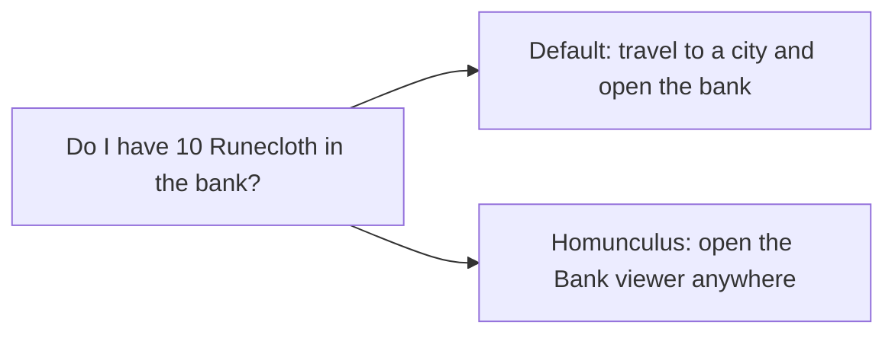
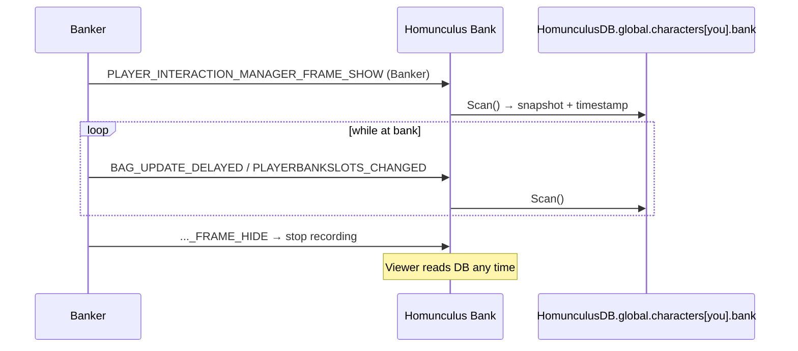

# Bank

- **Add-on:** `Homunculus_Bank`
- **Module:** `Bank`
- **Status:** Scaffolded, untested in game
- **Opened from:** the *Bank* button in [Bags](../bags/README.md), the [Homunculus menu](../menu/README.md) (*Open ▸ Bank*), or `/hom bank`

## Summary

Check what's in your bank, or any of your characters' banks, from anywhere. Each time you talk to a banker, Homunculus saves a snapshot of that character's bank. The viewer has a character picker showing names in class colors ([ADR 0003](../../adr/0003-show-character-and-class-color.md)), plus when the snapshot was taken.

## What it solves



## How it works



## Code highlights

**Supports both bank layouts** ([`Homunculus/Core/Containers.lua`](../../../Homunculus/Core/Containers.lua)). Recent Mainline clients use bank *tabs*; classic used a bank container plus bank bags:

```lua
if Enum.BagIndex.CharacterBankTab_1 then -- tabs
    ...
else
    ids[1] = BANK_CONTAINER -- classic bank + bank bags
```

**Snapshots live in core's account-wide DB**, keyed by character, so turning the add-on off never deletes them ([ADR 0002](../../adr/0002-every-component-is-a-toggleable-addon.md)):

```lua
Homunculus:GetCharacterStore().bank = { scannedAt = time(), containers = containers }
```

**Read-only slots** (`Homunculus.CreateDisplaySlot`) show tooltips and support shift-click linking without pretending the items can be used.

## Design decisions

- **Character picker.** It opens on the current character and lists every character with a saved bank (current first). "Live" shows only for the character you're playing.
- **Only occupied slots are shown**, so a large tabbed bank doesn't become a wall of empty squares.
- **Fires `BankScanned`**, so future components (e.g. cross-character search, a Warlock shard total) can react.

## Combat & secret-value constraints

None expected. Bank access and the viewer don't involve combat data.

## Screenshots

_TODO: never visited, live at bank, stale snapshot._

## Open questions / roadmap

- Search within the bank, and across bags and bank.
- Verify on Forever which bank layout is used, and that `PLAYERBANKSLOTS_CHANGED` exists (it's skipped safely if not).
