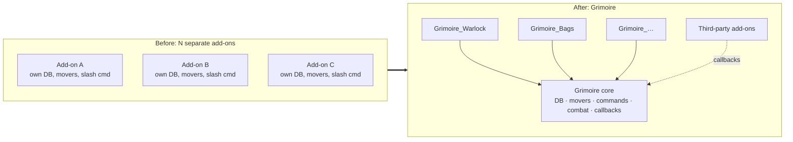
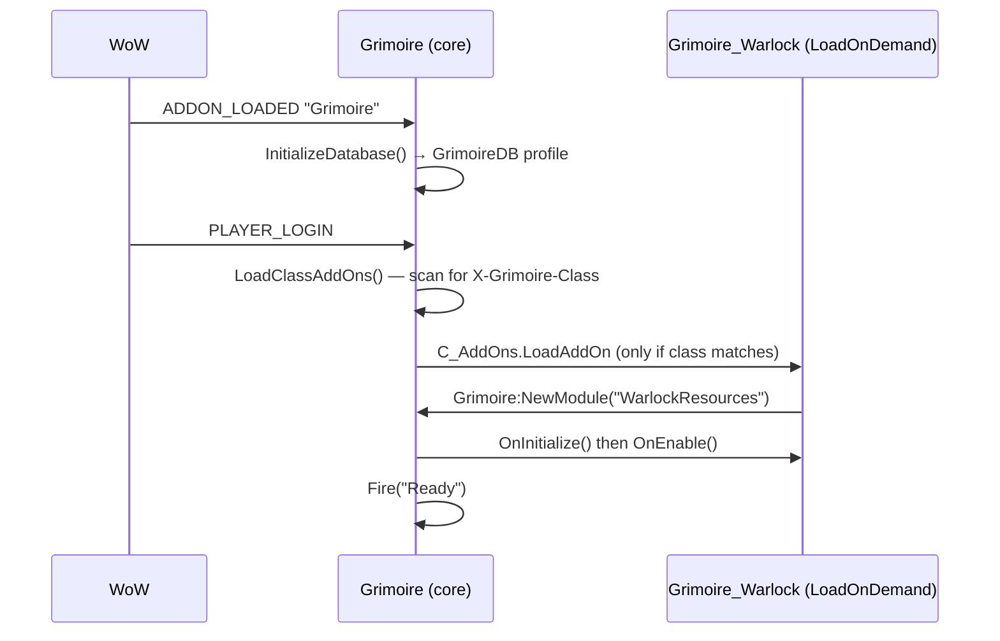
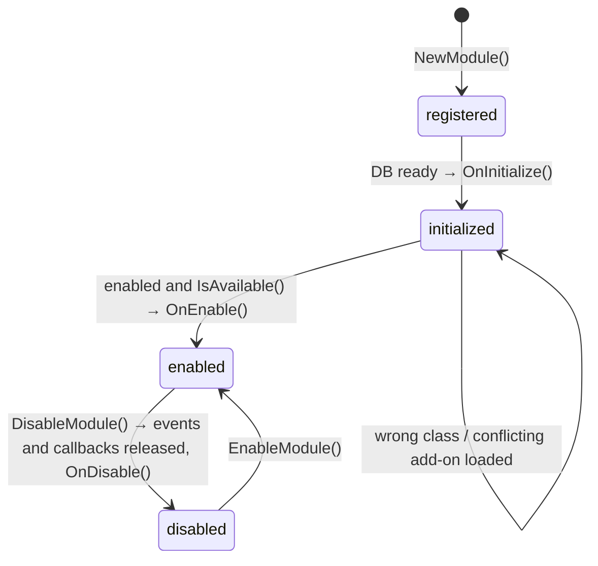
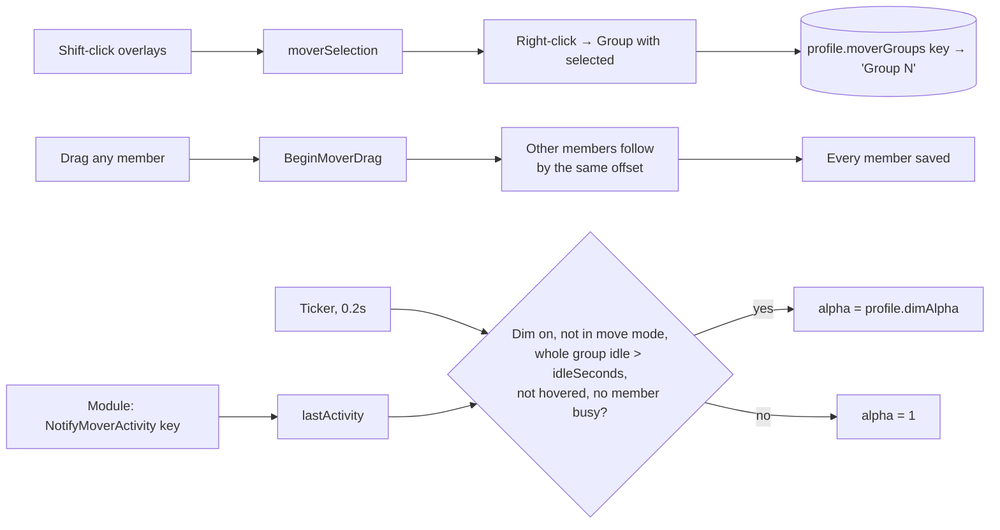

# Core framework

- **Add-on:** `Grimoire`
- **Status:** Scaffolded
- **Replaces:** Nothing directly. It's the shared foundation that lets every other feature replace an add-on.

## Summary

The core holds no visible features. It provides the shared infrastructure that every Grimoire feature builds on: a module system, per-character profiles, draggable frames, combat-safe deferral, a callback bus, and `/grimoire` commands. Class- and feature-specific code lives in separate `Grimoire_*` add-ons that plug into it.

## What it solves

Replacing many third-party add-ons with your own usually ends up as a pile of unrelated scripts. Each one has its own saved variables, its own way of moving frames, its own slash command and its own combat bugs. The core solves those problems once.



## How it works

### Load sequence



### Module lifecycle



## Code highlights

**Declaring a module** gives you defaults merged into per-profile settings, a class gate, and conflict detection ([`Core/Modules.lua`](../../../Grimoire/Core/Modules.lua)):

```lua
local M = Grimoire:NewModule("WarlockResources", {
    class = "WARLOCK",
    conflicts = { "SomeOtherShardAddon" }, -- skip ourselves if the user still runs it
    defaults = { width = 220 },
})
```

**Settings the menu shows** ([ADR 0005](../../adr/0005-modules-describe-their-settings.md)). A module names its add-on and describes its settings; core builds the [manager menu](../menu/README.md) from that and calls `ApplySettings(key)` when one changes:

```lua
local ADDON_NAME = ...
local M = Grimoire:NewModule("Bags", {
    addon = ADDON_NAME,
    label = "Bags",
    defaults = { columns = 10 },
    options = {
        { type = "choice", key = "columns", label = "Columns", values = { { 8, "8" }, { 10, "10" } } },
        -- { type = "toggle", key = "showText", label = "Show %" }; either may add reload = true
    },
})
function M:ApplySettings(key) --[[ re-layout ]] end
```

`Module:RegisterMover(frame, label, default, { dim, isBusy, suffix })` registers a mover keyed `module.name .. (suffix or "")`. `isBusy` returning true keeps the frame and its group from dimming.

The `conflicts` list is what makes gradual migration safe. You can keep an old add-on installed while Grimoire's replacement matures, and the two won't fight.

**Class packages load on demand**, driven by TOC metadata rather than hard-coded lists:

```
## LoadOnDemand: 1
## X-Grimoire-Class: WARLOCK
```

**Events belong to the module**, so disabling it can never leave a stray handler running:

```lua
self:RegisterUnitEvent("UNIT_POWER_FREQUENT", "player", "OnPowerEvent")
-- DisableModule() → UnregisterAllEvents() + UnregisterAllCallbacks(module)
```

**Combat-safe deferral** ([`Core/Combat.lua`](../../../Grimoire/Core/Combat.lua)). Protected frames can't move in combat, so the change is queued:

```lua
Grimoire:RunOutOfCombat(function()
    frame:ClearAllPoints()
    frame:SetPoint(...)
end)
```

**Secret-value guards** ([`Core/Util.lua`](../../../Grimoire/Core/Util.lua)):

```lua
if Grimoire.AnySecret(current, max) then
    bar.text:SetText(current)      -- widgets may display secrets
else
    bar.text:SetFormattedText("%d%%", current / max * 100) -- maths only on plain values
end
```

### Movers, groups and idle dimming

Any frame registered with `Grimoire:RegisterMover(frame, key, label, default, { dim = true })` gets a move-mode overlay (from the Launcher or `/grimoire unlock`). Windows from `CreateWindow` are movers automatically.



- **Groups** merge: grouping a frame that's already in a group pulls the whole group in. A group left with one member dissolves.
- **Dimming is per group.** "Dim when idle" applies to every member, and a group stays bright while any member is changing, hovered or busy (`isBusy`, e.g. a bar that isn't full).
- **Core owns mover alpha.** Modules report changes with `Grimoire:NotifyMoverActivity(key)` and never call `SetAlpha` on their mover frame.

## Design decisions

- **Own framework instead of Ace3.** The needs are small, and the code stays readable and dependency-free. AceDB/AceConfig can be pulled in via `.pkgmeta` externals if an options panel grows complex.
- **Global `Grimoire` table.** Required for cross-add-on modules, and it doubles as a public API for third-party integration.
- **Unknown events are skipped.** Forever is a Classic-family client whose API may differ from both Classic Era and retail, so modules can register legacy *and* modern events and only the real ones are used.
- **Own `inCombat` flag.** `InCombatLockdown()` still reports false inside the `PLAYER_REGEN_DISABLED` handler.

## Combat & secret-value constraints

- Movers lock automatically when combat starts.
- Dragging a window in combat is allowed, unless its group contains a protected frame (e.g. the secure aura headers).
- Profile switches apply on `/reload`.
- Callbacks are wrapped with `pcall`, so one broken listener can't break the others.

## Callbacks (public API)

| Callback | Args | When |
| --- | --- | --- |
| `Ready` | — | After login and initial module setup |
| `CombatStart` / `CombatEnd` | — | Entering / leaving combat |
| `MoversUnlocked` / `MoversLocked` | — | `/grimoire unlock` / `lock` (or combat auto-lock) |
| `ModuleEnabled` / `ModuleDisabled` | `name` | Module state changes |
| `MoverGroupsChanged` | — | Movers were grouped, ungrouped or selection cleared |
| `PositionsReset` | — | Layout ▸ Reset all positions (frames that aren't movers, like the launcher, reset themselves) |
| `BankScanned` | — | `Grimoire_Bank` saved a new snapshot |
| `AuctionsScanned` | — | `Grimoire_Auctions` saved a new snapshot |

## Shared toolkit

Code that more than one component needs lives in core, so components never depend on each other ([ADR 0002](../../adr/0002-every-component-is-a-toggleable-addon.md)).

| Helper | File | Purpose |
| --- | --- | --- |
| `Grimoire:CreateWindow(key, title, owner?)` | `Core/Widgets.lua` | Classic dialog window: header, close button, Escape to close; registered as mover `<key>Window` (listed in `owner`'s menu) |
| `Grimoire.OpenMenu(anchor, entries)` | `Core/Widgets.lua` | Context menu (nested via `children`) using Blizzard's Menu API, or `UIDropDownMenu` on older clients; `anchor` nil opens at the cursor |
| `Grimoire:GetMainMenu()` | `Core/Menu.lua` | The [manager menu](../menu/README.md); also `/grim menu` |
| `Grimoire:SetModuleSetting(module, key, value)` | `Core/Modules.lua` | Change a declared setting and apply it live (`ApplySettings`) |
| `Grimoire:RegisterMover` / `Module:RegisterMover` / `NotifyMoverActivity` | `Core/Movers.lua`, `Core/Modules.lua` | Move mode, groups, idle dimming (see above); the module version records the key for the menu |
| `Grimoire:HideBlizzardFrame(frame)` | `Core/Util.lua` | Hide a default frame a component replaces (reparented, events off; `/reload` after disabling restores it) |
| `Grimoire.CreateStatusBar` / `UpdateUnitBar` / `SetUnitRightClickMenu` / `UnitLevelText` / `BindingLabel` | `Core/UnitFrames.lua` | Pieces for frames holding several units in one mover (party, target): bars with Dead/Ghost/Offline, the unit menu, difficulty-coloured level, short keybind labels |
| `Grimoire:NewUnitBar(name, opts)` / `NewUnitPortrait(name, opts)` | `Core/UnitFrames.lua` | Health/power bar and portrait modules for any unit (player, pet); hide without the unit, except in move mode |
| `Grimoire.CreateStatusBar` / `UpdateUnitBar` / `SetUnitRightClickMenu` / `UnitLevelText` / `BindingLabel` | `Core/UnitFrames.lua` | Pieces for frames holding several units in one mover (party, target): bars with Dead/Ghost/Offline, the unit menu, difficulty-coloured level, short keybind labels |
| `Grimoire:GetAddOnButtonMenu()` / `GetAddOnButtons()` | `Core/AddOnButtons.lua` | Other add-ons' minimap buttons (LibDBIcon/LDB via `LibStub`, plus loose minimap buttons) as menu entries: Open, Options, Show on minimap; hidden ones saved in `profile.addonButtons` |
| `Grimoire.CreateRoundButton(name, parent?)` | `Core/Widgets.lua` | Minimap-style round button (Grimoire button, Notes button); set `button.icon` |
| `Grimoire.CreateScrollArea(parent, name, child?)` | `Core/Widgets.lua` | Scroll frame with scrollbar |
| `Grimoire.CreateDisplaySlot` / `SetDisplaySlotItem` | `Core/Widgets.lua` | Read-only item slot (tooltip, shift-click link) for cached items |
| `Grimoire.GetBagIDs` / `GetBankIDs` / `ReadContainer` | `Core/Containers.lua` | Inventory reading, including both bank-bag and bank-tab layouts |
| `Grimoire:GetCharacterStore()` | `Core/Characters.lua` | Account-wide, per-character storage in `GrimoireDB.global.characters` |
| `Grimoire:FormatCharacterName` / `ClassColorText` / `GetClassColor` | `Core/Characters.lua` | Class-colored character names and text ([ADR 0003](../../adr/0003-show-character-and-class-color.md)) |
| `Grimoire:GetCharactersWith(field)` | `Core/Characters.lua` | Characters with stored data, current first |
| `Grimoire.CreateCharacterPicker(parent, field, onChange)` | `Core/Widgets.lua` | Class-colored character selector (uses `OpenMenu`, or cycles if no menu API) |
| `Grimoire.FormatAgo` / `FormatMoney` | `Core/Util.lua` | "3h ago", coin strings |
| `Module:RegisterEvent` | `Core/Modules.lua` | Silently skips events this client doesn't have |

## Screenshots

_Not applicable beyond `/grimoire unlock` mover overlays. Add one once tested in game._

## Open questions / roadmap

- More setting types (sliders, colours) for the [manager menu](../menu/README.md) ([ADR 0005](../../adr/0005-modules-describe-their-settings.md)).
- Profile copy/delete commands.
- DB migrations keyed on `GrimoireDB.version`.
