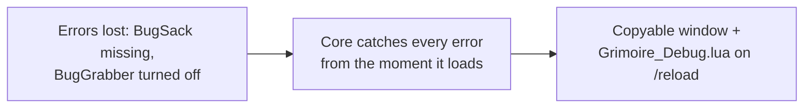
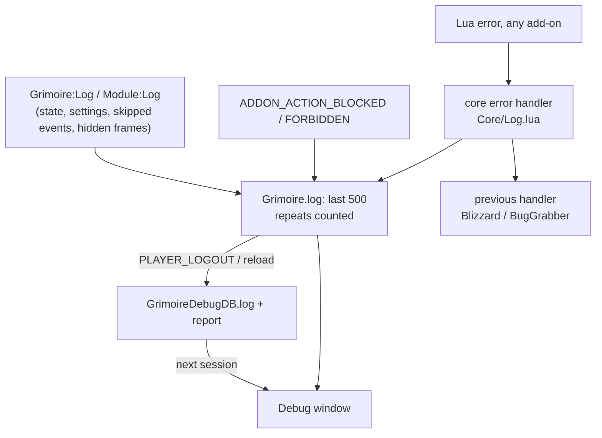

# Debug

- **Add-on:** `Grimoire_Debug` (window, report, saving); logging itself is in core (`Grimoire/Core/Log.lua`)
- **Module(s):** `Debug`
- **Status:** Scaffolded, untested in game
- **Replaces:** BugSack (and BugGrabber's saved errors)
- **Opened from:** the [Grimoire menu](../menu/README.md) (*Debug ▸ Show log*, or a component's *Debug log ▸ Show its log*), or `/grim debug` (`/grim debug report` for the report)

## Summary

One place for everything that goes wrong: Grimoire's own log (modules turning on and off, settings changed, Blizzard frames hidden, events this client lacks) and **every Lua error and blocked-action pop-up in the game**, from any add-on. The window shows it as plain text you can select and copy; an environment report lists the client, add-ons, modules and frame positions. Both are saved to `SavedVariables\Grimoire_Debug.lua` on `/reload` and logout, so Claude can read them directly.

## What it solves



## How it works



- **Levels:** error, warn, info, debug. Each component's level is set in its menu (*Debug log ▸ Errors only / Normal / Everything*); *Debug ▸ Log everything* sets them all. Errors are always kept.
- **Earlier sessions:** the saved log is loaded back and shown above "this session", so an error from before a `/reload` is still there.
- **First error:** chat says once per session that an error was logged.
- **Error count on the Grimoire button** (learned from BugSack): a red badge counts errors logged this session that the log hasn't shown yet; opening the log clears it (`Grimoire.errorCount` / `errorsSeen`, callback `ErrorCountChanged`).

## Code highlights

**Errors are caught in core, not in the Debug add-on** ([`Core/Log.lua`](../../../Grimoire/Core/Log.lua)). Core loads before any component, so its error handler sees errors in every Grimoire add-on's own loading. It records, then hands the error on, so BugGrabber (if on) still gets it:

```lua
local previousHandler = geterrorhandler()
seterrorhandler(function(message, ...)
    -- record (guarded against errors while recording), then:
    return previousHandler(message, ...)
end)
```

**Messages can't break logging.** Values are formatted in `pcall`; a secret value becomes `<secret>`, and a format that doesn't fit its values falls back to listing them.

**Read-only but copyable.** The window is an edit box whose typing is undone, so selecting and Ctrl+C work.

## Design decisions

- **Logging in core, display in a component** (ADR 0002): every component logs without depending on Debug; the Debug menus appear only while Debug is on (`GetModule("Debug")`).
- **Plain text, no colour codes**, so what you copy is exactly what's shown.
- **500 entries** in memory and on disk; an error repeating every frame is one entry with a count.

## Combat & secret-value constraints

Nothing here is protected. Secret values never reach a comparison or the saved file: they're logged as `<secret>`.

## Settings

| Key | Default | Description |
| --- | --- | --- |
| `GrimoireDB.global.logLevels[<module>]` | `info` | Per component: `off` (errors only), `info`, `debug` |
| `GrimoireDB.global.logLevels["*"]` | — | `debug` when *Log everything* is on |

## Screenshots

_None yet._

## Open questions / roadmap

- More core log points from the plan: grouping and ungrouping, old-API fallbacks (auctions, bank layout, menu API).
