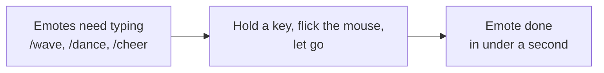
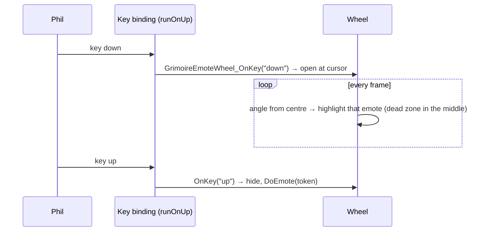

# Emote wheel

- **Add-on:** `Grimoire_Emotes`
- **Module(s):** `EmoteWheel`
- **Status:** Scaffolded, untested in game
- **Replaces:** emote-wheel add-ons; typing `/wave`, `/dance` …
- **Opened by:** holding its key (Key Bindings ▸ Grimoire ▸ *Emote wheel (hold)*), the [Grimoire menu](../menu/README.md) (*Open ▸ Emote wheel*), or `/grim emotes`

## Summary

A ring of eight emotes that opens at the mouse while you hold a key. Point toward one and let go: your character does it (with the usual chat line, aimed at your target if you have one). Letting go near the centre does nothing. Opened from the menu or `/grim emotes`, the wheel stays open until you click an emote or press Esc.

## What it solves



## How it works



## Code highlights

**Hold-and-release from one binding** ([`Bindings.xml`](../../../Grimoire_Emotes/Bindings.xml)). `runOnUp="true"` calls the binding on both press and release, with `keystate` set to `"down"` or `"up"`.

**Picking by angle** ([`EmoteWheel.lua`](../../../Grimoire_Emotes/EmoteWheel.lua)). The first emote sits at the top, the rest clockwise; the pointer's angle from the centre is rounded to the nearest slice, so you only need to move toward an emote, not onto it:

```lua
local index = math.floor((math.pi / 2 - atan2(dy, dx)) / step + 0.5) % #EMOTES + 1
```

**Classic art** (ADR 0001). Each emote is a `Grimoire.CreateRoundButton` (minimap-button style, fixed size) on a faint disc made from the minimap button's background.

## Design decisions

- **Emotes, not chat icons** (Phil, 2026-10-16). WoW has no emoji; emotes are the closest thing, and chat can only show the eight raid-marker icons.
- **Hold a key** (Phil's choice) rather than a button, so it works mid-fight without the mouse leaving the action.
- **Fixed eight emotes for now:** Wave, Cheer, Dance, Laugh, Bow, Thank, Cry, Roar. The icons are game icons picked to suggest each emote; any that don't exist on Forever show blank (the label still shows).

## Combat & secret-value constraints

`DoEmote` isn't protected and the wheel isn't a secure frame, so it works in combat.

## Settings

None yet. Bind the key in **Key Bindings ▸ Grimoire ▸ Emote wheel (hold)**.

## Screenshots

_None yet._

## Open questions / roadmap

- Choosing which emotes are on the wheel (a menu of common emotes per slice).
- Icon choices to check in game.
