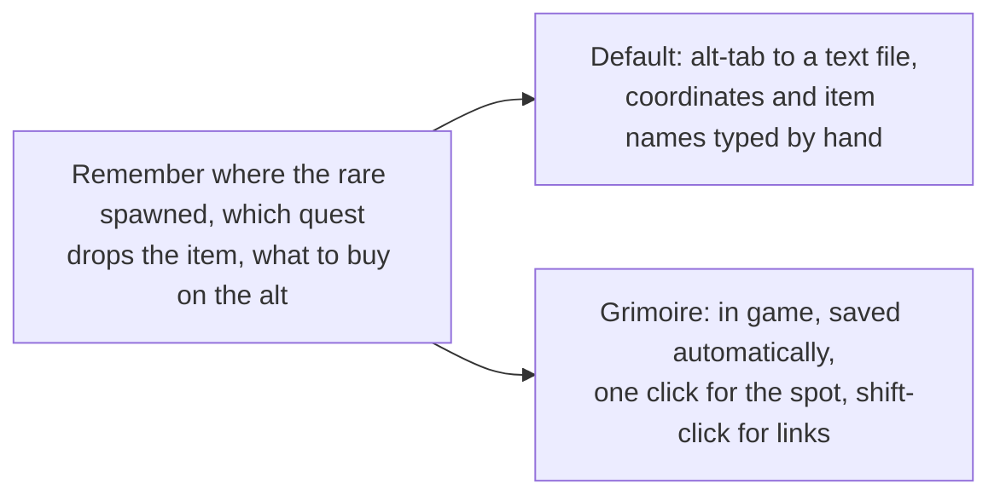
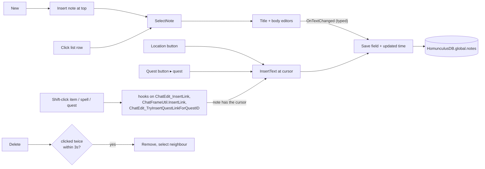

# Grimoire

- **Add-on:** `Homunculus_Grimoire` (called Notes, `Homunculus_Notes`, before [ADR 0010](../../adr/0010-rename-to-homunculus.md))
- **Module:** `Grimoire`
- **Status:** Scaffolded, untested in game; locations and links are new (2026-10-17)
- **Opened from:** the floating Grimoire button, the [Homunculus menu](../menu/README.md) (*Open ▸ Grimoire*), or `/hom grimoire` (`/hom notes` still works)

## Summary

Your in-game notebook: a list of notes on the left, title and text on the right. Notes are account-wide, so every character sees them, and they save as you type. Each note remembers which character wrote it and shows in that character's class color: a Warlock's notes are purple ([ADR 0003](../../adr/0003-show-character-and-class-color.md)).

A note can hold more than text:
- **Location:** the button adds where you are, e.g. `Razor Hill, Durotar (52.4, 43.1)`.
- **Quest:** the button lists the quests in your log; pick one to add its link.
- **Shift-click** an item (bags, bank, loot, character sheet), a spell or a quest while writing, and its link goes into the note, just as it would into chat.

Links show in the game's colours in the editor, and copy into chat as real links.

## What it solves



## How it works



## Code highlights

**Autosave only on typing** ([`Grimoire.lua`](../../../Homunculus_Grimoire/Grimoire.lua)). The `userInput` flag tells real typing apart from `SetText` when switching notes; inserted locations and links save explicitly:

```lua
body:SetScript("OnTextChanged", function(box, userInput)
    if userInput then self:Save("body", box:GetText()) end
    ScrollingEdit_OnTextChanged(box, bodyScroll)
end)
```

**Shift-click links without replacing Blizzard code.** The game hands every shift-clicked link to the chat box's insert function. Grimoire hooks it with `hooksecurefunc`, which runs after the game's own code and changes nothing of Blizzard's, so nothing is tainted. One click can reach two hooks (when one function calls the other), so a repeat of the same link in the same frame is ignored:

```lua
function M:OnLinkClicked(link)
    if not (self.body and self.body:HasFocus() and type(link) == "string") then return end
    local now = GetTime()
    if self.lastLink == link and self.lastLinkTime == now then return end
    self.lastLink, self.lastLinkTime = link, now
    self:InsertText(link)
end
```

**Two-click delete instead of a popup.** Adding entries to Blizzard's `StaticPopupDialogs` is a known source of taint.

## Design decisions

- **Account-wide**, not per character, but each note stores its `author` and `class`. The list and title use the author's class color, and the footer reads "Edited 5m ago by <name>".
- **Newest first** by creation order. Editing doesn't reorder the list, so notes don't jump around while you type.
- **Links are stored as the game's own link text** (`|Hitem:…|h[…]|h`) in the note body, so they look and copy exactly like chat links. The editor can't make them clickable (WoW edit boxes don't support link clicks); paste a note line into chat to click one.
- **Locations are plain text** (`Subzone, Zone (x, y)`, map coordinates 0–100): readable as is, and the same format as the coordinates in Prophecy plans. In instances, where the map has no position, only the place name is added.
- **Quest picker as well as shift-click:** the modern quest log only offers quest links to an open chat box, so the Quest button lists your log directly. The shift-click hook covers it where the client allows.
- **Classic look**: dialog window, tooltip-style panels, quest-log highlight on rows, Blizzard buttons.
- **Its own floating button, not a Bags button** (your call). The Grimoire has nothing to do with bags, and it should be reachable with Bags turned off (or replaced by Baganator). The button is built by the shared `Homunculus.CreateModuleButton` (also used by Tempo and Prophecy): the same minimap-style art and size as the Homunculus button (*Layout ▸ Button size*), with the game's note icon. Turn it off in the menu if you'd rather use *Open ▸ Grimoire*.
- **Renamed from Notes** ([ADR 0010](../../adr/0010-rename-to-homunculus.md)): the module copies the old `Notes` settings, window and button positions once, on first load. The notes themselves stay in `global.notes`.

## Combat & secret-value constraints

None. Works in combat. Secret map coordinates fall back to the place name.

## Settings

Stored in `HomunculusDB.profiles[<profile>].modules.Grimoire`. In the menu: **Components ▸ Grimoire**.

| Key | Default | Menu choices | Description |
| --- | --- | --- | --- |
| `showButton` | true | toggle | Show the floating Grimoire button |

The button is a normal mover (`GrimoireButton`): drag it in move mode, and the menu offers *Grimoire button: Reset position* and *Dim when idle*.

## Screenshots

_TODO: a note with a location, an item link and a quest link; the Quest menu._

## Open questions / roadmap

- Keybind to toggle.
- Search notes.
- Set a waypoint from a location in a note (TomTom, as Prophecy does).
- Per-character or per-zone notes, e.g. one that pops up when entering a dungeon.
