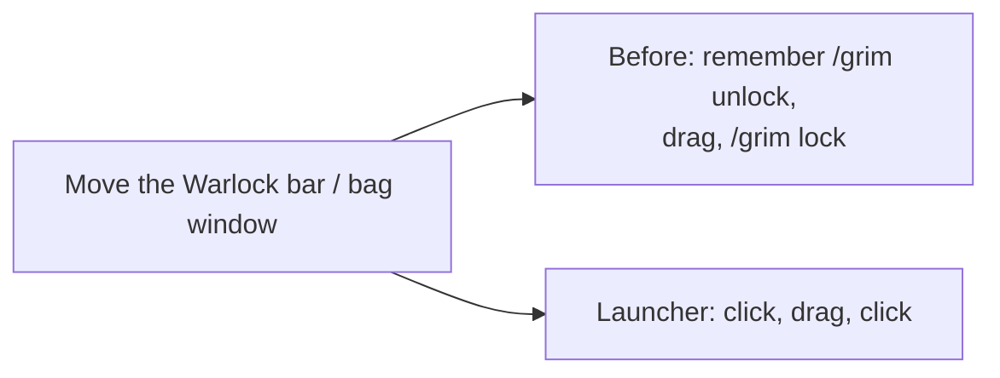
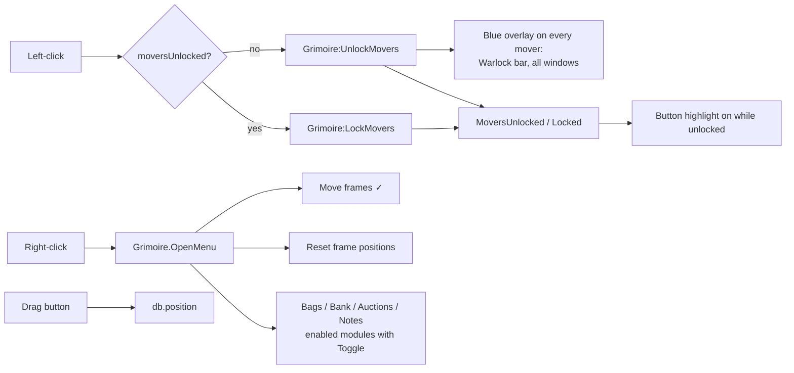

# Launcher

- **Add-on:** `Grimoire_Launcher`
- **Module:** `Launcher`
- **Status:** Scaffolded, untested in game
- **Replaces:** Minimap-button collections and per-add-on "unlock" commands

## Summary

One round Grimoire button that floats wherever you put it (it isn't attached to the minimap). Left-click it to turn move mode on, drag any Grimoire frame or window, then left-click again to lock. Right-click for a menu with move mode, reset, and every Grimoire window.

## What it solves



The bottom-right micro menu has no room for a ninth button on the Classic layout, so a free-floating button is the reliable spot.

## How it works



## Code highlights

**Windows are movers too** ([`Grimoire/Core/Widgets.lua`](../../../Grimoire/Core/Widgets.lua)). `CreateWindow` registers every window as a mover, so move mode and reset treat windows and bars the same way. Windows can still be dragged any time:

```lua
self:RegisterMover(frame, moverKey, title, { "CENTER", "UIParent", "CENTER", 0, 0 })
```

**The menu lists whatever is installed** ([`Launcher.lua`](../../../Grimoire_Launcher/Launcher.lua)). Any enabled module with a `Toggle` method gets an entry, so new windows show up without touching the launcher (ADR 0002):

```lua
if module ~= self and module.Toggle and module:IsEnabled() then
```

**One menu helper in core.** `Grimoire.OpenMenu(anchor, entries)` uses Blizzard's Menu API when present and `UIDropDownMenu` otherwise. The character picker uses it too.

## Design decisions

- **Free-floating, not on the minimap** (your call). It uses the classic round-button art so it still looks like part of the game (ADR 0001).
- **Not in the micro menu.** The Classic layout runs the micro buttons straight into the bag buttons; a ninth button would overlap the backpack.
- **Icon from the game's own files.** No bundled textures (ADR 0001). `/grimoire icon` cycles through built-in tome icons; `/grimoire icon <file name>` picks any icon by name.
- **The button isn't itself a mover.** A move-mode overlay would cover it and stop you clicking it to lock again, so it's dragged directly and saves its own position.

## Combat & secret-value constraints

Unlocking is refused in combat and movers lock when combat starts (core behaviour). The button isn't protected, so it can still be dragged and opens its menu in combat.

## Settings

Stored in `GrimoireDB.profiles[<profile>].modules.Launcher`.

| Key | Default | Description |
| --- | --- | --- |
| `position` | bottom-right, above the bags | Button position |
| `icon` | `INV_Misc_Book_09` | Icon file name under `Interface\Icons` |

## Screenshots

_TODO: add to `screenshots/`. Suggested: button, tooltip, menu, move mode with overlays._

## Open questions / roadmap

- Pick a final icon in game.
- Move-mode overlays for Blizzard frames we haven't replaced (player frame, target frame, minimap).
