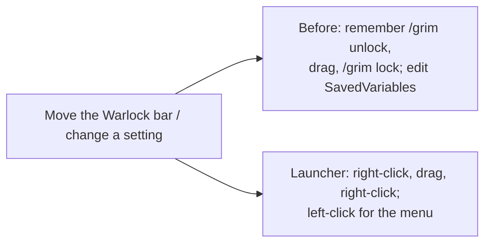
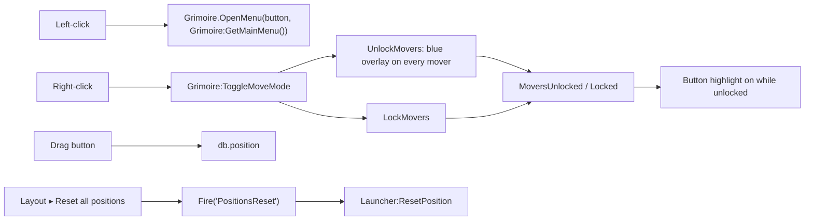

# Launcher

- **Add-on:** `Grimoire_Launcher`
- **Module:** `Launcher`
- **Status:** Scaffolded, untested in game
- **Replaces:** Minimap-button collections and per-add-on "unlock" commands

## Summary

One round Grimoire button that floats wherever you put it (it isn't attached to the minimap). **Left-click** opens the [Grimoire menu](../menu/README.md): open windows, manage components and their settings, layout options, Reload UI. **Right-click** toggles move mode, so you can drag any Grimoire frame or window, then right-click again to lock. Drag the button itself to move it. Right-clicking a frame's overlay in move mode has its own options: select, group, *Dim when idle*, reset.

## What it solves



The bottom-right micro menu has no room for a ninth button on the Classic layout, so a free-floating button is the reliable spot.

## How it works



## Code highlights

**The menu lives in core** ([`Grimoire/Core/Menu.lua`](../../../Grimoire/Core/Menu.lua)). The launcher only opens it, so the menu still works with the launcher turned off (`/grim menu`):

```lua
if mouseButton == "RightButton" then
    Grimoire:ToggleMoveMode()
else
    Grimoire.OpenMenu(b, Grimoire:GetMainMenu())
end
```

**One size for every round button** ([`Grimoire/Core/Widgets.lua`](../../../Grimoire/Core/Widgets.lua)). The Grimoire, Notes, Tempo and Prophecy buttons all take *Layout ▸ Button size* (profile `buttonSize`). The art is resized rather than the button scaled, so saved positions don't move. The launcher used to have its own `scale`; a position saved at that scale is converted once to screen units:

```lua
local savedScale = self.db.positionScale or self.db.scale
if savedScale and savedScale ~= 1 then
    pos[3], pos[4] = pos[3] * savedScale, pos[4] * savedScale
end
```

**Windows are movers too** ([`Grimoire/Core/Widgets.lua`](../../../Grimoire/Core/Widgets.lua)). `CreateWindow` registers every window as a mover, so move mode and reset treat windows and bars the same way.

## Design decisions

- **Left-click is the menu** (your call). The menu is used more often than move mode, and it now covers everything the button did before.
- **Bigger by default, and the same as every other button** (Phil, 2026-10-16: "all the buttons need to be larger and the same size"). The size is a shared Layout setting, default Large (44 px).
- **Free-floating, not on the minimap** (your call). It uses the classic round-button art so it still looks like part of the game (ADR 0001).
- **Not in the micro menu.** The Classic layout runs the micro buttons straight into the bag buttons; a ninth button would overlap the backpack.
- **Icon from the game's own files.** No bundled textures (ADR 0001). `/grim icon` cycles through built-in tome icons; `/grim icon <file name>` picks any icon by name.
- **The button isn't itself a mover.** A move-mode overlay would cover it and stop you clicking it to lock again, so it's dragged directly and saves its own position. *Reset all positions* resets it too, through the `PositionsReset` callback.

## Combat & secret-value constraints

Unlocking is refused in combat and movers lock when combat starts (core behaviour). The button isn't protected, so it can still be dragged and opens its menu in combat.

## Settings

Stored in `GrimoireDB.profiles[<profile>].modules.Launcher`. In the menu: **Components ▸ Launcher**.

| Key | Default | Description |
| --- | --- | --- |
| `position` | bottom-right, above the bags | Button position |

The button's size is the shared *Layout ▸ Button size* (profile `buttonSize`: Small 31, Medium 38, Large 44, Huge 52 px).
| `icon` | `INV_Misc_Book_09` | Icon file name under `Interface\Icons` |

## Screenshots

_TODO: add to `screenshots/`. Suggested: button, tooltip, menu, move mode with overlays._

## Open questions / roadmap

- Pick a final icon in game.
- Move-mode overlays for Blizzard frames we haven't replaced (target frame, minimap).
