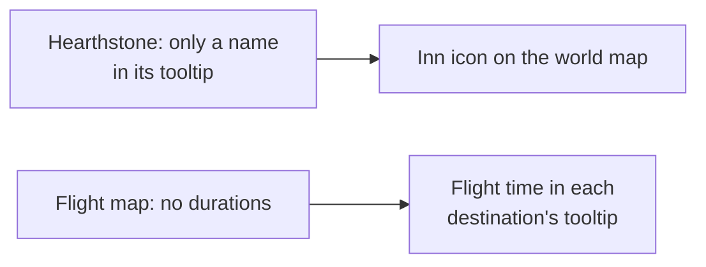
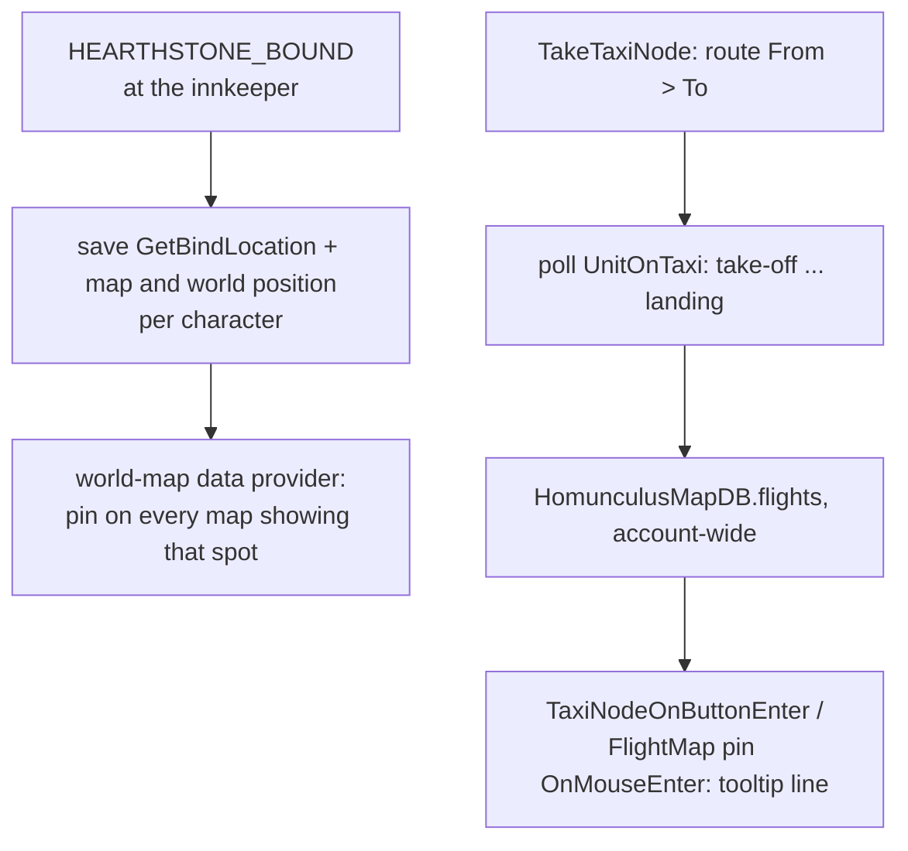

# Map

- **Add-on:** `Homunculus_Map`
- **Module(s):** `Hearth` (Hearthstone on the map), `FlightTimes` (Flight times)
- **Status:** Scaffolded, untested in game
- **Replaces:** the flight-time feature of Leatrix Plus

## Summary

Two map additions Phil asked for (2026-10-16):
- **Hearthstone on the map:** an inn icon on the world map where your hearthstone is set; hovering it names the place and the character.
- **Flight times:** hovering a destination on the flight map shows how long that flight takes, learned from your own flights.

## What it solves

## How it works

- **Hearthstone:** the game tells add-ons the place's name (`GetBindLocation`) but not where it is, so the spot is saved when you set your hearthstone. One set before this add-on existed has no spot yet: the map shows "Hearthstone: <place> (set it again at an innkeeper to pin it on the map)" in its corner until you do.
- **Flights:** timed from take-off to landing and saved per route ("Orgrimmar > Crossroads"). A flight cut short (under 80% of the known time, or *Request early landing*) isn't saved.

## Code highlights

**Pins without XML** ([`Hearth.lua`](../../../Homunculus_Map/Hearth.lua)). The pin pool is registered on the map in Lua, as the HereBeDragons library does for Questie and TomTom on this client, including its fix for an in-combat error (`SetPassThroughButtons`).

**Any map that shows the spot.** The saved world position is converted to whichever map is open (`C_Map.GetMapPosFromWorldPos`), so the pin shows on the zone and the continent.

**Both flight maps** ([`Flights.lua`](../../../Homunculus_Map/Flights.lua)): the classic `TaxiFrame` (hooked like Leatrix Plus does on this client) and, if shown, the modern `Blizzard_FlightMap`.

## Design decisions

- **Learned, not shipped:** no bundled flight-time tables; Forever's own routes are learned the same way as the old ones.
- **Per character** hearthstones (ADR 0003: the tooltip names the character); flight times are account-wide, since routes are the same for everyone.

## Combat & secret-value constraints

Nothing here is protected. A secret player position isn't saved.

## Settings

Each module can be turned off in **Components ▸ Map**. Data: `HomunculusMapDB`.

## Screenshots

_None yet._

## Open questions / roadmap

_None._
