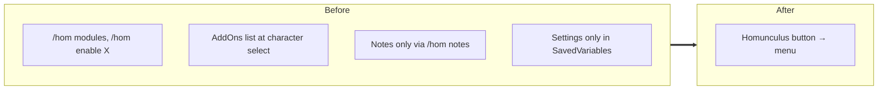
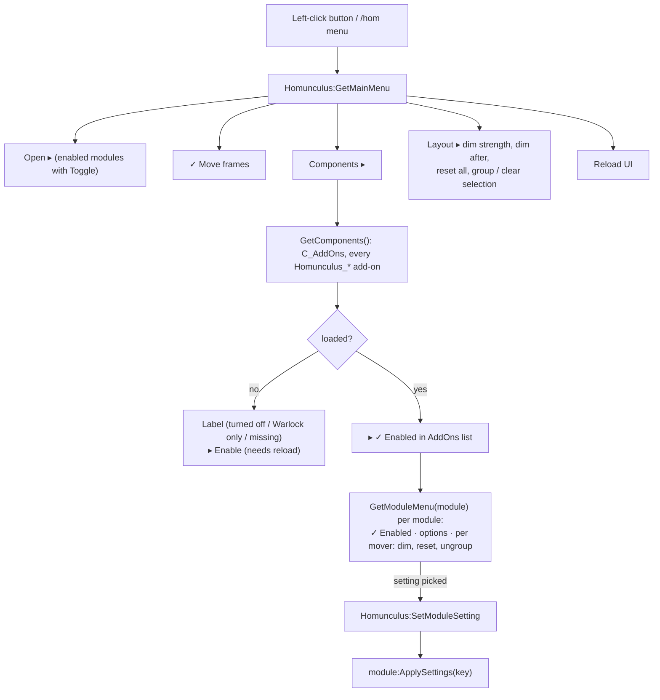

# Manager menu

- **Add-on:** `Homunculus` (core, [`Core/Menu.lua`](../../../Homunculus/Core/Menu.lua))
- **Opened by:** left-clicking the [Homunculus button](../launcher/README.md), or `/hom menu` (opens at the cursor)
- **Status:** Scaffolded, untested in game
- **Replaces:** Slash commands for managing components; the AddOns list for checking what loaded

## Summary

One nested pop-up menu that manages all of Homunculus from inside the game. It opens any window, toggles move mode, and lists every `Homunculus_*` add-on with its status. Each component's submenu turns it on or off, changes its settings live, and handles its frames' position, dimming and grouping. Nothing is hard-coded per component: the menu is built from what's installed and what each module says about itself ([ADR 0005](../../adr/0005-modules-describe-their-settings.md)).

## What it solves



## How it works

The menu is rebuilt each time it opens, so it always matches the current state.



### Example: the Player component

```
Components ▸
  Player ▸
    ✓ Enabled in AddOns list
    Health ▸
      ✓ Enabled
      ✓ Show %
      Width ▸   ○ 180  ● 220  ○ 260  ○ 300
      Height ▸  ○ 12   ● 16   ○ 20   ○ 24
      ─────────
      ✓ Dim when idle
      Reset position
    Power (mana) ▸
      ...
  Warlock (Warlock only)        ← on a non-Warlock character
```

An add-on with one module (Bags, Grimoire, Launcher, ...) lists that module's entries directly instead of a nested submenu.

## Code highlights

**Submenus in `OpenMenu`** ([`Core/Widgets.lua`](../../../Homunculus/Core/Widgets.lua)). An entry with `children` becomes a submenu on both menu systems. With Blizzard's Menu API it recurses into the element description. With `UIDropDownMenu` the children ride along as `menuList` and come back for deeper levels:

```lua
UIDropDownMenu_Initialize(dropdown, function(_, level, menuList)
    AddDropDownEntries((level or 1) > 1 and menuList or entries, level)
end, "MENU")
```

**Status from the client, not from Homunculus** ([`Core/Menu.lua`](../../../Homunculus/Core/Menu.lua)). An add-on that didn't load can't register anything, so its status comes from `C_AddOns.GetAddOnInfo`. Class packages are recognised by their `X-Homunculus-Class` tag:

```lua
local name, title, _, loadable, reason = C_AddOns.GetAddOnInfo(i)
```

**One path for every setting** ([`Core/Modules.lua`](../../../Homunculus/Core/Modules.lua)). `SetModuleSetting` writes `module.db`, calls `ApplySettings(key)` so the change shows at once, and says when a `/reload` is needed. A change made while the module is off is applied when it's next enabled.

**Mover keys belong to modules.** `Module:RegisterMover` and `CreateWindow(key, title, owner)` record each frame's mover key on its module, so the module's submenu can offer that frame's dim, reset and ungroup options.

## Design decisions

- **Settings are toggles or picks from presets.** No sliders or text boxes, so everything fits in a dropdown and works on both menu systems (your call).
- **Built in core, opened by the launcher.** The launcher only shows the menu. Any other component, or `/hom menu`, can open it too, and the launcher stays optional (ADR 0002).
- **Turning an add-on off needs a reload.** `C_AddOns.DisableAddOn` only changes the AddOns list. The menu says so and offers *Reload UI*, which works because it runs from a click.
- **Enabled (module) vs. Enabled in AddOns list (add-on).** Turning a module off is instant and can be undone without a reload. Turning the add-on off stops its code from loading at all, which is the safety net from ADR 0002.
- **Layout sharing** (2026-10-16, learned from Shadowed Unit Frames / ElvUI): *Layout ▸ Export layout* shows the profile's frame positions, groups, dimming, dim strength and delay, button size and every component's settings as text (`# Homunculus layout v1` + data); *Import layout* checks pasted text and replaces this profile's layout, then a Reload button applies it. The text is read by `Core/Serialize.lua`, never run, and only those settings are accepted (`Core/Layout.lua`).
- **Every setting explains itself** (2026-10-16, learned from Leatrix Plus): options carry a one-line `tooltip`, shown on hover; settings that need a reload say so.
- **Dim strength and dim delay are profile settings** (`dimAlpha`, `idleSeconds`), so each character can have its own.

## Combat & secret-value constraints

The menu itself isn't protected and opens in combat. Settings that touch protected frames (aura rows and icons per row) are deferred with `RunOutOfCombat`. Move mode can't be turned on in combat.

## Settings

Stored in `HomunculusDB.profiles[<profile>]`. Component settings are listed in each component's doc.

| Key | Default | Description |
| --- | --- | --- |
| `dimAlpha` | 0.4 | Layout ▸ Dim strength: Faint 0.2, Medium 0.4, Light 0.6 |
| `idleSeconds` | 1.5 | Layout ▸ Dim after: 1, 1.5 or 3 seconds |
| `buttonSize` | 44 | Layout ▸ Button size: every round Homunculus button (Homunculus, Grimoire, Tempo, Prophecy): Small 31, Medium 38, Large 44, Huge 52 px |

## Screenshots

_TODO: add to `screenshots/`. Suggested: main menu, Components list with a turned-off add-on, a component submenu with settings._

## Open questions / roadmap

- **Debug ▸** submenus for the log and log levels (Milestone 2, `Homunculus_Debug`).
- Verify in game which menu system Forever uses (Menu API or `UIDropDownMenu`), and that radio and checkbox entries refresh in place.
- Does `C_AddOns.DisableAddOn` without a character name apply to every character or only this one on Forever?
