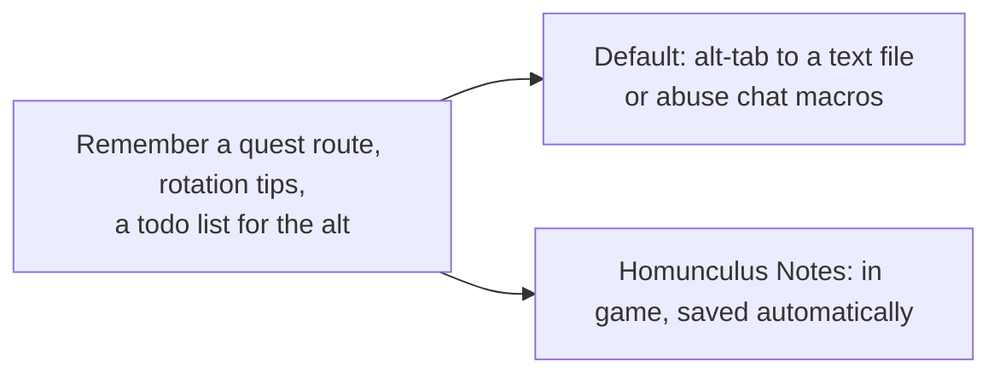
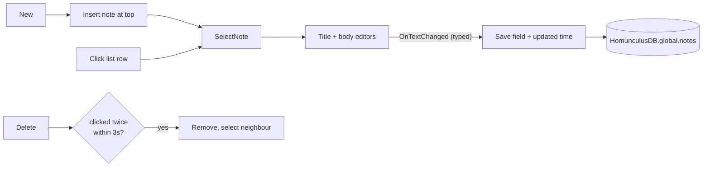

# Notes

- **Add-on:** `Homunculus_Notes`
- **Module:** `Notes`
- **Status:** Scaffolded, untested in game
- **Opened from:** the floating Notes button, the [Homunculus menu](../menu/README.md) (*Open ▸ Notes*), or `/hom notes`

## Summary

A simple in-game notebook: a list of notes on the left, title and text on the right. Notes are account-wide, so every character sees them, and they save as you type. Open it from its own floating button (optional, on by default), the Homunculus menu, or `/hom notes`. Each note remembers which character wrote it and shows in that character's class color: a Warlock's notes are purple ([ADR 0003](../../adr/0003-show-character-and-class-color.md)).

## What it solves



## How it works



## Code highlights

**Autosave only on typing** ([`Notes.lua`](../../../Homunculus_Notes/Notes.lua)). The `userInput` flag tells real typing apart from `SetText` when switching notes:

```lua
body:SetScript("OnTextChanged", function(box, userInput)
    if userInput then self:Save("body", box:GetText()) end
    ScrollingEdit_OnTextChanged(box, bodyScroll)
end)
```

**Two-click delete instead of a popup.** Adding entries to Blizzard's `StaticPopupDialogs` is a known source of taint:

```lua
if self.confirmingDelete then self:DeleteSelected() return end
self.deleteButton:SetText("Confirm?")
```

## Design decisions

- **Account-wide**, not per character, but each note stores its `author` and `class`. The list and title use the author's class color, and the footer reads "Edited 5m ago by <name>".
- **Newest first** by creation order. Editing doesn't reorder the list, so notes don't jump around while you type.
- **Classic look**: dialog window, tooltip-style panels, quest-log highlight on rows.
- **Its own floating button, not a Bags button** (your call). Notes has nothing to do with bags, and it should be reachable with Bags turned off (or replaced by Baganator). The button is built by the shared `Homunculus.CreateModuleButton` (also used by Tempo and Prophecy): the same minimap-style art and size as the Homunculus button (*Layout ▸ Button size*), with the game's note icon. Turn it off in the menu if you'd rather use *Open ▸ Notes*.

## Combat & secret-value constraints

None. Works in combat.

## Settings

Stored in `HomunculusDB.profiles[<profile>].modules.Notes`. In the menu: **Components ▸ Notes**.

| Key | Default | Menu choices | Description |
| --- | --- | --- | --- |
| `showButton` | true | toggle | Show the floating Notes button |

The button is a normal mover (`NotesButton`): drag it in move mode, and the menu offers *Notes button: Reset position* and *Dim when idle*.

## Screenshots

_TODO: empty state, a few notes, delete confirmation._

## Open questions / roadmap

- Keybind to toggle.
- Search notes.
- Per-character or per-zone notes, e.g. one that pops up when entering a dungeon.
