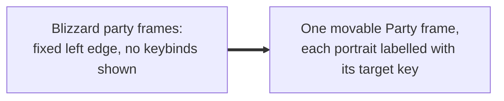
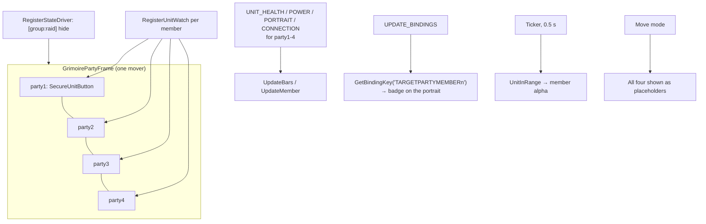

# Party frames

- **Add-on:** `Grimoire_Party` ([`Party.lua`](../../../Grimoire_Party/Party.lua))
- **Module:** `Party`
- **Status:** Scaffolded, untested in game
- **Replaces:** Blizzard's party frames; unit-frame add-ons' party frames

## Summary

Your party in one movable frame: up to four members, each in Blizzard's classic party frame style (portrait in a gold ring, class-coloured name, health and mana bars, leader crown). Every portrait shows the key that targets that member (F2–F5 by default). Members out of range fade. Left-click a member to target them, right-click for their menu. The members sit inside the one "Party" frame, so the party moves as a whole and can't be split up.

## What it solves



## How it works



## Code highlights

**Members are widgets, not movers** ([`Party.lua`](../../../Grimoire_Party/Party.lua)). Each member is a secure unit button laid out inside one holder frame, and only the holder is registered as a mover. That's what makes the party move as one (Phil's request):

```lua
button:SetPoint("TOPLEFT", self.holder, "TOPLEFT", 0, -(i - 1) * step)
...
self:RegisterMover(holder, "Party", { "TOPLEFT", "UIParent", "TOPLEFT", 20, -160 })
```

**No group header.** Forever lacks `SecureAuraHeaderTemplate`, and `SecureGroupHeaderTemplate` ships in the same Blizzard file, so it may be missing too. Party units always fill `party1`..`partyN` in order, so four fixed slots, each shown by `RegisterUnitWatch`, give the same result and work in combat.

**Keybinding badge.** `Grimoire.BindingLabel("TARGETPARTYMEMBER2")` returns the first key bound to that command, shortened for a badge (`F3`, `s2` for Shift-2, `cN3` for Ctrl-Numpad 3), and it refreshes on `UPDATE_BINDINGS`.

**Shared pieces from core** ([`Core/UnitFrames.lua`](../../../Grimoire/Core/UnitFrames.lua)): `CreateStatusBar`, `UpdateUnitBar` (health or power, with Dead/Ghost/Offline), `SetUnitRightClickMenu`, `BindingLabel`. The target frame uses the same ones.

## Design decisions

- **Classic art** ([ADR 0001](../../adr/0001-prefer-classic-style-ui.md)): Blizzard's `UI-PartyFrame` texture with the portrait and bars in its slots, and names in class colour ([ADR 0003](../../adr/0003-show-character-and-class-color.md)).
- **One mover, fixed slots** (Phil's request): nothing can be dragged apart. Size and spacing are settings instead.
- **Hidden in raids by default**, until Grimoire has raid frames (backlog).
- **Out-of-range fading** sets the member's own alpha; the frame's idle dimming (core) is separate and off by default. Forever can return the range check as secret booleans (seen 2026-10-17); those go to `SetAlphaFromBoolean` untested, and where that call doesn't exist the member stays fully visible.
- **Blizzard's party frames are hidden** ([ADR 0004](../../adr/0004-components-replace-blizzard-ui.md)). Their party-pet frames are children and go with them; Grimoire has no party-pet frames yet.

## Combat & secret-value constraints

- Members are protected: created, laid out and resized out of combat; they show and hide with the party in combat through their unit watches.
- Health and power update in combat; secret values show raw.

## Settings

Stored in `GrimoireDB.profiles[<profile>].modules.Party`. In the menu: **Components ▸ Party**.

| Key | Default | Menu choices | Description |
| --- | --- | --- | --- |
| `scale` | 1 | Small 0.9 / Normal 1 / Large 1.2 / Huge 1.4 | Member size |
| `spacing` | `normal` | Compact / Normal | Gap between members |
| `showText` | false | toggle | % on the bars |
| `showInRaid` | false | toggle | Keep showing the party frames in a raid |
| `hideBlizzard` | true | toggle (needs `/reload` to turn off) | Hide Blizzard's party frames |

## Screenshots

_TODO: add to `screenshots/`. Suggested: a party of four with badges, move mode placeholders, an out-of-range member._

## Open questions / roadmap

- Verify in game: the art lines up with the portrait and bars (positions are Blizzard's classic numbers), the right-click menu on Forever, and `UnitInRange` for party members.
- Party pets, buffs and debuffs on members.
