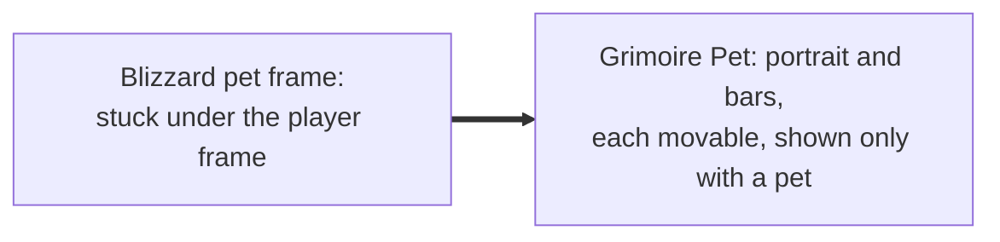
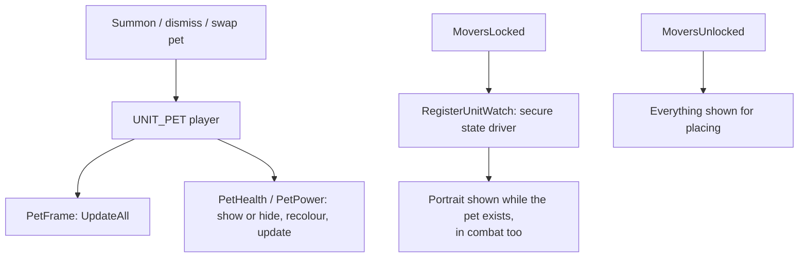

# Pet

- **Add-on:** `Grimoire_Pet` ([`Pet.lua`](../../../Grimoire_Pet/Pet.lua))
- **Modules:** `PetFrame`, `PetHealth`, `PetPower` (built on core's unit frames, [`Core/UnitFrames.lua`](../../../Grimoire/Core/UnitFrames.lua))
- **Status:** Scaffolded, untested in game
- **Replaces:** Blizzard's pet frame; unit-frame add-ons' pet frame

## Summary

Your pet's frame, a size smaller than the [player frame](../player-frame/README.md): an animated 3D portrait (or classic 2D) with name and level, plus health and power bars. Everything shows only while you have a pet out (your Imp, Voidwalker, Succubus or Felhunter), and always in move mode so you can place it. Left-click the portrait to target your pet; right-click for Blizzard's pet menu (rename, dismiss). Blizzard's pet frame is hidden ([ADR 0004](../../adr/0004-components-replace-blizzard-ui.md)).

## What it solves



## How it works



## Code highlights

**Three modules, no new frame code** ([`Pet.lua`](../../../Grimoire_Pet/Pet.lua)). The portrait and bars come from core's unit frame toolkit, the same one [Grimoire Player](../player-frame/README.md) uses. The pet only adds what's different, like left-click targeting:

```lua
function PetFrame:BuildExtras()
    self.frame:SetAttribute("type1", "target")
end
```

**Showing in combat.** The portrait is a secure unit button, which add-on code can't show or hide in combat. A secure state driver (`RegisterUnitWatch`) shows it whenever the pet exists. Move mode swaps that for a plain `Show`, so it can be placed without a pet. The bars aren't protected and simply follow `UNIT_PET`.

## Design decisions

- **Its own component** (your call), split from Grimoire Player: turn it off in the AddOns list if you play a class without a pet, or would rather keep Blizzard's ([ADR 0002](../../adr/0002-every-component-is-a-toggleable-addon.md)).
- **Shared code lives in core** (`Core/UnitFrames.lua`), so Player and Pet share it without depending on each other.
- **Left-click targets** the pet, the usual unit-frame behaviour.
- **No pet emotes.** Creature models don't have the player emote animations. Your own portrait waves when your pet appears.
- **Pet power has no % by default**: the bar is thin.

## Combat & secret-value constraints

- The portrait is protected: created, resized and moved only out of combat; it shows and hides in combat through the unit watch.
- The bars aren't protected and update freely.

## Settings

Module names are unchanged from when these lived in Grimoire Player, so saved settings and positions carry over. In the menu: **Components ▸ Pet**.

`GrimoireDB.profiles[<profile>].modules.PetFrame`:

| Key | Default | Menu choices | Description |
| --- | --- | --- | --- |
| `style` | `animated` | Animated (3D) / Classic (2D) / Portrait bar | Portrait type; the Portrait bar shows health and power itself, so the pet bars hide while it's on |
| `size` | 48 | Small 36 / Medium 48 / Large 64 | Portrait size (a Portrait bar is four times as wide) |
| `showName` | true | toggle | Pet name above the portrait (on the bar in the Portrait bar style) |
| `showText` | true | toggle | Portrait bar style: health value and % on the bar |
| `hideBlizzard` | true | toggle (needs `/reload` to turn off) | Hide Blizzard's pet frame |

`.modules.PetHealth` / `.PetPower`:

| Key | Default | Menu choices | Description |
| --- | --- | --- | --- |
| `showText` | true (health), false (power) | toggle | Show % on the bar |
| `width` | 150 | 120 / 150 / 180 / 220 | Bar width |
| `height` | 12 (health), 8 (power) | health 8 / 10 / 12 / 16; power 6 / 8 / 10 / 12 | Bar height |
| `manaColor` | `{0, 0, 1}` | — | Power only: mana colour (other pets use Blizzard's power colours) |

## Screenshots

_TODO: add to `screenshots/`. Suggested: pet frame and bars under the player's, move mode without a pet._

## Open questions / roadmap

- Verify in game: frames appear and disappear on summon and dismiss, including in combat; right-click opens the pet menu on Forever.
- Pet happiness (hunters) and pet buffs/debuffs.
