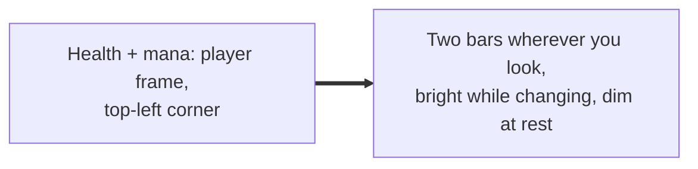
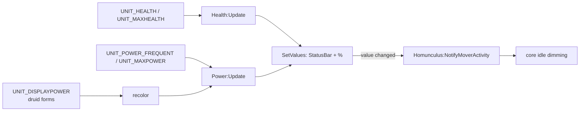

# Player bars

- **Add-on:** `Homunculus_Player`
- **Modules:** `Health`, `Power` (built on core's unit bars, [`Core/UnitFrames.lua`](../../../Homunculus/Core/UnitFrames.lua))
- **Status:** Scaffolded, untested in game
- **Replaces:** Player health/mana bar add-ons

## Summary

A health bar and a power bar (mana, or rage/energy for other classes), each its own movable frame. Your pet's bars are in [Homunculus Pet](../pet/README.md). Put them under your character, group them so they move together, and let them dim when nothing's changing.

## What it solves



## How it works



## Code highlights

**Built on core's unit bars** ([`Bars.lua`](../../../Homunculus_Player/Bars.lua)). Each bar is one `Homunculus:NewUnitBar` call: a kind (`health` or `power`), a unit and its defaults. [Homunculus Pet](../pet/README.md) builds its bars the same way. They are separate modules, so each can be toggled (`/hom disable Power`) and moved on its own.

**Activity only on real changes.** A bar that's regenerating reports activity every tick and stays bright; a full bar stops reporting and dims after the idle time (1.5s by default):

```lua
elseif current ~= self.lastCurrent or max ~= self.lastMax then
    self.lastCurrent, self.lastMax = current, max
    Homunculus:NotifyMoverActivity(self.name)
end
```

**Never dim in combat or while not full.** The bars pass an `isBusy` check to their mover. While it returns true, core treats the bar (and its whole group) as active:

```lua
function Bar:IsBusy()
    if Homunculus:InCombat() or not self.lastCurrent then
        return true -- in combat, or the value is secret
    end
    return self.lastCurrent < self.lastMax
end
```

**Live settings.** Changing width, height or *Show %* in the menu calls `ApplySettings`, which resizes the frame and redraws the text straight away.

## Design decisions

- **Classic colors** ([ADR 0001](../../adr/0001-prefer-classic-style-ui.md)): pure green health, `{0, 0, 1}` mana blue (kept as a setting, `manaColor`). Other power types use Blizzard's `PowerBarColor`.
- **Health 16px, power 12px**, in the classic player frame's order.
- **Dim when idle is on by default** for both, but a bar only dims when it's full, out of combat and unchanged for the idle time. You want them bright whenever they matter.
- **Blizzard's player frame is replaced** by the [player frame](../player-frame/README.md) (portrait, name, level, menus), which hides it. The bars are its health and mana.
- **Hidden under the Portrait bar style:** when the player frame uses it, health and mana are on the frame itself, so these bars hide (and come back when the style changes or the frame is turned off).

## Combat & secret-value constraints

If combat makes values opaque, the bar still fills, the raw value shows instead of a percentage, and every update counts as activity. Neither frame is protected.

## Settings

Stored in `HomunculusDB.profiles[<profile>].modules.Health` / `.Power`. In the menu: **Components ▸ Player ▸ Health / Power (mana)**. Position, group and dimming are mover settings (see [Core](../core/README.md)).

| Key | Default | Menu choices | Description |
| --- | --- | --- | --- |
| `showText` | true | toggle | Show % on the bar |
| `width` | 220 | 180 / 220 / 260 / 300 | Bar width |
| `height` | 16 (Health), 12 (Power) | Health 12 / 16 / 20 / 24; Power 8 / 10 / 12 / 16 | Bar height |
| `manaColor` | `{0, 0, 1}` | — | Power only: mana color |

## Screenshots

_TODO: add to `screenshots/`. Suggested: changing (bright), idle (dim), grouped in move mode._

## Open questions / roadmap

- Target bars on the same code (`NewUnitBar` with `unit = "target"`).
