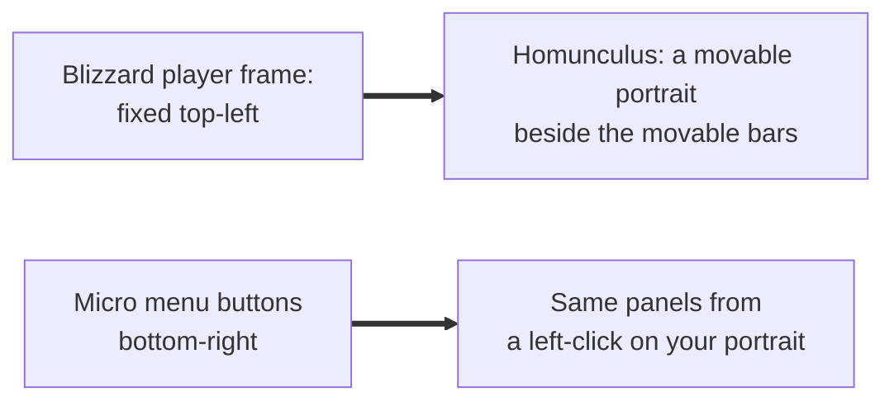

# Player frame

- **Add-on:** `Homunculus_Player` ([`Portrait.lua`](../../../Homunculus_Player/Portrait.lua))
- **Module:** `PlayerFrame` (built on core's unit portrait, [`Core/UnitFrames.lua`](../../../Homunculus/Core/UnitFrames.lua))
- **Status:** Scaffolded, untested in game
- **Replaces:** Blizzard's player frame (portrait, name, level, health and mana bars); unit-frame add-ons' player frame

## Summary

A movable portrait of your character, animated in 3D by default, with your name in class colour, your level, and status icons (resting, in combat, group leader, PvP). It cheers when you level up, laughs or cries when you die, and waves when someone joins your party or your pet appears. Left-click it for a menu of every game panel (Character Info through Game Menu) plus the Homunculus menu; right-click for Blizzard's player menu. Blizzard's player frame is hidden ([ADR 0004](../../adr/0004-components-replace-blizzard-ui.md)); health and mana are the separate [Health/Power bars](../player-bars/README.md).

Your pet has its own component, [Homunculus Pet](../pet/README.md).

## What it solves



## How it works


## Code highlights

**A secure button with an insecure left-click** ([`Portrait.lua`](../../../Homunculus_Player/Portrait.lua)). Right-click goes through Blizzard's secure unit menu, so it works in combat. Left-click has no secure action; a hook opens Homunculus's menu:

```lua
frame:SetAttribute("type2", "togglemenu")
frame:HookScript("OnClick", function(b, mouseButton)
    if mouseButton == "LeftButton" then
        Homunculus.OpenMenu(b, self:GetClickMenu())
    end
end)
```

**The click menu follows the micro menu.** The entries are the micro buttons the client actually has, found at runtime in their on-screen order (`MICRO_BUTTONS`, else the `MicroMenu` container), so Forever's own buttons (Legacy, Shop, its Group Finder) appear without being listed in Homunculus. Labels come from each button's tooltip ("Character Info (C)" → "Character Info"). Known panels open through their toggle function; anything else, or a toggle the client lacks, clicks the button itself. An entry only shows while its button is shown (so Talents appears at level 10), and it checks `IsShown`, not `IsVisible`, so the menu keeps working after the micro menu itself is hidden.

**Add-ons ▸: other add-ons' minimap buttons** ([`Core/AddOnButtons.lua`](../../../Homunculus/Core/AddOnButtons.lua), Phil's request). Every add-on with a minimap button gets an entry with **Open** (its left-click), **Options** (its right-click) and **✓ Show on minimap**, plus **Hide all minimap buttons** at the end. Buttons are found at runtime: LibDBIcon / LibDataBroker launchers through `LibStub` (no dependency), and any other named button on the minimap. Hidden buttons are saved per profile in `profile.addonButtons` and re-hidden after login and whenever LibDBIcon creates a button.

```lua
entries[#entries + 1] = { text = ADDONS or "Add-ons", children = Homunculus:GetAddOnButtonMenu() }
```

**Built on core's unit portrait.** `Homunculus:NewUnitPortrait` (in [`Core/UnitFrames.lua`](../../../Homunculus/Core/UnitFrames.lua)) builds the secure button, 3D model or 2D texture, name, level, size and style settings, and hiding the Blizzard frame. This module adds the click menu, status icons and emotes. [Homunculus Pet](../pet/README.md) uses the same base.

**Emotes are model animations.** `PlayerModel:SetAnimation` with the emote animation IDs: wave 67, cheer 68, laugh 70, cry 77. The model returns to standing on `OnAnimFinished`, or after 3 seconds on clients without it.

**Blizzard's player frame is hidden in place** ([ADR 0007](../../adr/0007-hide-blizzard-frames-in-place.md)): its events and its bars' events are switched off and a secure state driver keeps it hidden, but it's never reparented. Forever runs the retail UI, and reparenting an Edit Mode frame tainted Edit Mode (`TargetUnit()` blocked) and broke Blizzard's secret-value code. Frames inside it go with it: Blizzard's pet frame is replaced by [Homunculus Pet](../pet/README.md), so keep that on while this frame hides Blizzard's.

## Design decisions

- **Left-click is a menu, not "target yourself"** (your call). F1 still targets you. Right-click stays Blizzard's player menu.
- **Animated by default** (your call). A 3D model can't be clipped to a circle, so the frame is a square with the classic tooltip border, matching the bars. *Classic (2D)* shows the flat portrait in the same box.
- **Portrait bar style** (Phil's pick from a screenshot, 2026-10-17): one wide bar with the 3D model behind a see-through health fill, a thin mana strip under it, and your name, level and health on it; once you are hurt, your name gives way to the health %. Mirrored: the value is on the left, the level on the right. It shows health and mana itself, so the separate [Health and Power bars](../player-bars/README.md) hide while it's on. It keeps the classic border and bar texture ([ADR 0001](../../adr/0001-prefer-classic-style-ui.md)); only the layout is new, and it's a choice, not the default. The same style exists on the pet, target and party frames.
- **Emotes only on the 3D portrait** (animated or Portrait bar), and they can be turned off.
- **Blizzard's player frame is hidden by default** ([ADR 0004](../../adr/0004-components-replace-blizzard-ui.md)). Turning *Hide Blizzard player frame* off needs a `/reload`.
- **Classic look** ([ADR 0001](../../adr/0001-prefer-classic-style-ui.md)): Blizzard's status icons (`UI-StateIcon`, leader crown, PvP badges), fonts and border.

## Combat & secret-value constraints

- The frame is protected: it's created, resized and moved only out of combat (`RunOutOfCombat`); a group containing it can't be dragged in combat.
- Right-click works in combat (secure). Left-click menu entries open Blizzard panels from add-on code, which some clients block in combat for some panels.
- The frame never dims in combat (`isBusy`).

## Settings

Stored in `HomunculusDB.profiles[<profile>].modules.PlayerFrame`. In the menu: **Components ▸ Player ▸ Player frame**.

| Key | Default | Menu choices | Description |
| --- | --- | --- | --- |
| `style` | `animated` | Animated (3D) / Classic (2D) / Portrait bar | Portrait type |
| `size` | 64 | Small 48 / Medium 64 / Large 80 | Portrait size (a Portrait bar is four times as wide) |
| `showName` | true | toggle | Name above the portrait (on the bar in the Portrait bar style), in class colour |
| `showText` | true | toggle | Portrait bar style: health value on the bar, and the % in place of the name once hurt |
| `emotes` | true | toggle | Cheer, laugh/cry, wave |
| `hideBlizzard` | true | toggle (needs `/reload` to turn off) | Hide Blizzard's player frame |

Minimap buttons: `HomunculusDB.profiles[<profile>].addonButtons` = `{ hidden = { ["ldb:Questie"] = true, … }, hideAll = false }`, changed from **Add-ons ▸** in the click menu.

## Screenshots

_TODO: add to `screenshots/`. Suggested: the frame next to the bars, the click menu, an emote mid-animation._

## Open questions / roadmap

- Found in game (2026-10-13): Forever has no `ToggleSpellBook`, so the Spellbook entry errored. Toggle functions are now looked up when clicked, and a missing or failing one falls back to clicking the micro button.
- Verify in game: `togglemenu` vs. the dropdown player menu on Forever; `OnAnimFinished` on `PlayerModel`; the emote animation IDs; the pet frame's position after hiding.
- More emotes? (e.g. flex on a killing blow, dance when resting.)
- Verify in game: every add-on you use appears under Add-ons ▸ with the right name, Open and Options do what its minimap button does, and hidden buttons stay hidden after `/reload`.
