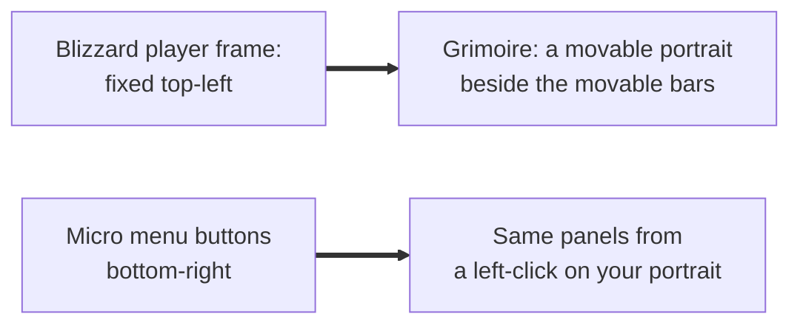
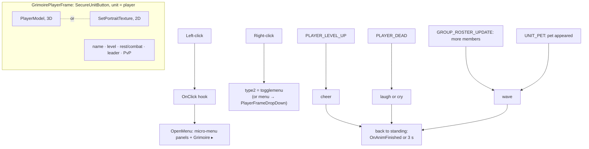

# Player and pet frames

- **Add-on:** `Grimoire_Player` ([`Portrait.lua`](../../../Grimoire_Player/Portrait.lua))
- **Modules:** `PlayerFrame`, `PetFrame`
- **Status:** Scaffolded, untested in game
- **Replaces:** Blizzard's player and pet frames (portrait, name, level, health and mana bars); unit-frame add-ons' player and pet frames

## Summary

A movable portrait of your character, animated in 3D by default, with your name in class colour, your level, and status icons (resting, in combat, group leader, PvP). It cheers when you level up, laughs or cries when you die, and waves when someone joins your party or your pet appears. Left-click it for a menu of every game panel (Character Info through Game Menu) plus the Grimoire menu; right-click for Blizzard's player menu. Blizzard's player frame is hidden ([ADR 0004](../../adr/0004-components-replace-blizzard-ui.md)); health and mana are the separate [Health/Power bars](../player-bars/README.md).

The **pet frame** is the same portrait, a size smaller (48 instead of 64), for your Imp, Voidwalker, Succubus or Felhunter. It shows only while you have a pet (and always in move mode, so you can place it). Left-click targets the pet; right-click opens Blizzard's pet menu (rename, dismiss). Its bars are the Pet health and Pet power bars. Blizzard's pet frame is hidden.

## What it solves



## How it works



## Code highlights

**A secure button with an insecure left-click** ([`Portrait.lua`](../../../Grimoire_Player/Portrait.lua)). Right-click goes through Blizzard's secure unit menu, so it works in combat. Left-click has no secure action; a hook opens Grimoire's menu:

```lua
frame:SetAttribute("type2", "togglemenu")
frame:HookScript("OnClick", function(b, mouseButton)
    if mouseButton == "LeftButton" then
        Grimoire.OpenMenu(b, self:GetClickMenu())
    end
end)
```

**The click menu follows the micro menu.** Each entry appears only if that micro button exists and is shown (so Talents appears at level 10, Guild only on clients that have it). It calls the panel's toggle function, falling back to clicking the micro button. It checks `IsShown`, not `IsVisible`, so the menu keeps working after the micro menu itself is hidden.

**Emotes are model animations.** `PlayerModel:SetAnimation` with the emote animation IDs: wave 67, cheer 68, laugh 70, cry 77. The model returns to standing on `OnAnimFinished`, or after 3 seconds on clients without it.

**The pet frame survives.** On Classic, `PetFrame` is a child of `PlayerFrame`, so hiding one would hide both. It's moved to `UIParent` at the same spot first (unless Grimoire's pet frame has already hidden it).

**One portrait, two units.** A shared `Portrait` base builds the frame, model or 2D texture, name and level for any unit; `PlayerFrame` and `PetFrame` add their own clicks, icons and events. The pet portrait shows and hides with the pet through a secure state driver, which works in combat. Move mode swaps it for a plain `Show` so it can be placed without a pet:

```lua
function Pet:ShowFrame()
    if Grimoire.moversUnlocked then
        UnregisterUnitWatch(self.frame)
        self.frame:Show()
    else
        RegisterUnitWatch(self.frame)
    end
end
```

## Design decisions

- **Left-click is a menu, not "target yourself"** (your call). F1 still targets you. Right-click stays Blizzard's player menu.
- **Animated by default** (your call). A 3D model can't be clipped to a circle, so the frame is a square with the classic tooltip border, matching the bars. *Classic (2D)* shows the flat portrait in the same box.
- **Emotes only on the 3D portrait,** and they can be turned off. The pet doesn't emote: creature models don't share the player emote animations.
- **Pet frame: left-click targets** the pet (the usual unit-frame behaviour; you asked for a smaller copy of the player frame, not its menu).
- **Blizzard's player frame is hidden by default** ([ADR 0004](../../adr/0004-components-replace-blizzard-ui.md)). Turning *Hide Blizzard player frame* off needs a `/reload`.
- **Classic look** ([ADR 0001](../../adr/0001-prefer-classic-style-ui.md)): Blizzard's status icons (`UI-StateIcon`, leader crown, PvP badges), fonts and border.

## Combat & secret-value constraints

- The frame is protected: it's created, resized and moved only out of combat (`RunOutOfCombat`); a group containing it can't be dragged in combat.
- Right-click works in combat (secure). Left-click menu entries open Blizzard panels from add-on code, which some clients block in combat for some panels.
- The frame never dims in combat (`isBusy`).

## Settings

Stored in `GrimoireDB.profiles[<profile>].modules.PlayerFrame`. In the menu: **Components ▸ Player ▸ Player frame**.

| Key | Default | Menu choices | Description |
| --- | --- | --- | --- |
| `style` | `animated` | Animated (3D) / Classic (2D) | Portrait type |
| `size` | 64 | Small 48 / Medium 64 / Large 80 | Portrait size |
| `showName` | true | toggle | Name above the portrait, in class colour |
| `emotes` | true | toggle | Cheer, laugh/cry, wave |
| `hideBlizzard` | true | toggle (needs `/reload` to turn off) | Hide Blizzard's player frame |

Pet frame: `GrimoireDB.profiles[<profile>].modules.PetFrame`. In the menu: **Components ▸ Player ▸ Pet frame**.

| Key | Default | Menu choices | Description |
| --- | --- | --- | --- |
| `style` | `animated` | Animated (3D) / Classic (2D) | Portrait type |
| `size` | 48 | Small 36 / Medium 48 / Large 64 | Portrait size |
| `showName` | true | toggle | Pet name above the portrait |
| `hideBlizzard` | true | toggle (needs `/reload` to turn off) | Hide Blizzard's pet frame |

## Screenshots

_TODO: add to `screenshots/`. Suggested: the frame next to the bars, the click menu, an emote mid-animation._

## Open questions / roadmap

- Verify in game: `togglemenu` vs. the dropdown player menu on Forever; `OnAnimFinished` on `PlayerModel`; the emote animation IDs; the pet frame's position after hiding.
- More emotes? (e.g. flex on a killing blow, dance when resting.)
