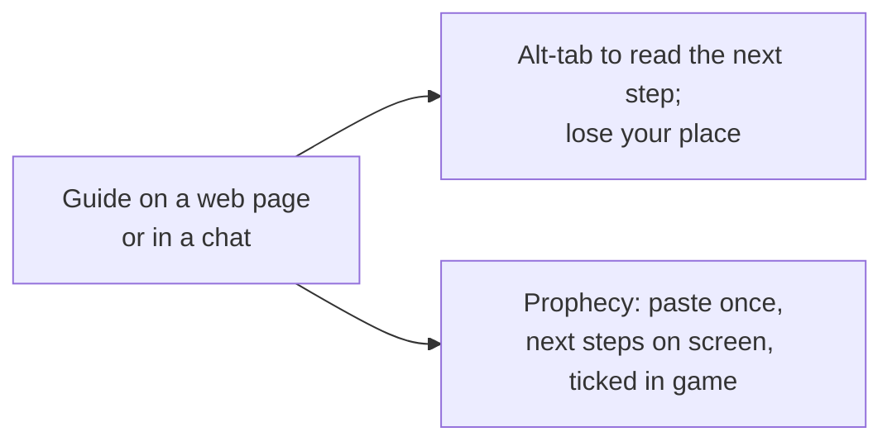
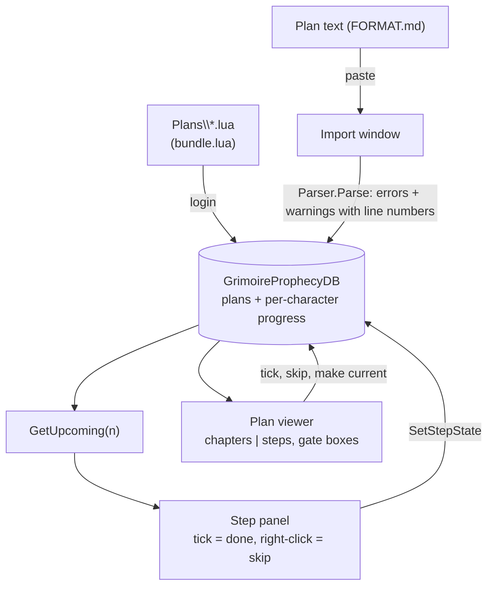
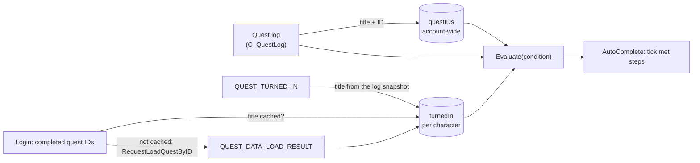

# Prophecy

- **Add-on:** `Grimoire_Prophecy`
- **Module:** `Prophecy`
- **Status:** Scaffolded, untested in game. Phase 5a (import, plan viewer, step panel) is done; 5b has started: quest steps tick themselves. The rest of 5b and 5c–5d are planned.
- **Replaces:** levelling-guide add-ons (Zygor, RestedXP, Questie's guide mode) for routes you write yourself
- **Opened from:** `/prophecy`, `/grim prophecy`, the [Grimoire menu](../menu/README.md) (*Open ▸ Prophecy*, also under the player portrait's *Grimoire ▸* menu), and the step panel's header

## Summary

Prophecy follows a levelling plan written outside the game. A plan is plain text in the [Prophecy format](../../prophecy/FORMAT.md), written by hand or by an agent. You paste it into the import window, where it's checked line by line, and it's saved for every character ([ADR 0006](../../adr/0006-prophecy-plans-are-pasted-text.md)). The step panel shows the current step and the next few, and you tick them off as you go. The plan viewer shows the whole plan, laid out like the web guide. Progress is kept per character.

The Troll Warlock 1–30 plan ships with the add-on, so there's nothing to paste for Phil's Warlock. A character with no plan picks a shipped or saved plan written for its class.

## What it solves



## How it works



What the panel shows (`M:GetUpcoming` in [`Prophecy.lua`](../../../Grimoire_Prophecy/Prophecy.lua)):
- Steps in plan order that aren't done or skipped. Notes (`n`) and reference chapters are left out.
- **Optional steps never hold the panel.** One drops out once you tick a later step in its chapter.
- **`minlevel`:** a step above your level waits, and the panel goes on without it. In the viewer its level shows in red.
- **Gates are advice.** A chapter's gate appears once its steps are handled. It stays until every check is ticked, you right-click it (*move on*), or you tick a step in a later chapter. The next chapter's steps show below it the whole time.

### Steps that tick themselves (quests)

A step whose `done` conditions are all quest conditions ticks itself ([`Quests.lua`](../../../Grimoire_Prophecy/Quests.lua)). The viewer and the step's tooltip show "Ticks itself: …".

| Condition | Met when |
| --- | --- |
| `accept [Q]` | Q is in your quest log, or you've turned it in |
| `complete [Q]` | Q's objectives are done (ready to turn in), or you've turned it in |
| `turnin [Q]` | You've turned Q in |

Plans name quests by title, but the game knows turned-in quests only by ID, so Prophecy bridges the two:



- Titles match without regard to case or punctuation (the game's "From The Wreckage...." matches `[From The Wreckage...]`). A plan can pin a quest with `[Name#123]`, which is checked by ID.
- Quest events come in bursts, so the log is read once they settle (0.3 s).
- **Un-ticking sticks.** If you un-tick a self-ticking step (or make it the current step), it's marked manual and doesn't tick itself again until you tick it. *Reset progress* clears that, so everything you've already done ticks itself again.
- A step that also uses a condition Prophecy can't read yet (level, skill, item, learn, reach, zone) stays manual. A gate target of that kind counts as not met, so the gate stays until you move on.

## Code highlights

**One parser, in game and on the command line.** [`Parser.lua`](../../../Grimoire_Prophecy/Parser.lua) is plain Lua 5.1 with no WoW API. The game loads it from the `.toc`, and `scripts/prophecy/check.lua` loads the same file with `dofile`, so the checker accepts exactly what the game does. The file finds out which one it's in from its varargs:

```lua
local _, ns = ...
...
if type(ns) == "table" then
    ns.Parser = Parser -- in game: shared with the rest of Grimoire_Prophecy
end
return Parser
```

**Step identity.** The parser gives every step an `id`: its chapter id plus a hash of its main line (`ch5:1a2b3c4d`). The hash is plain arithmetic, because WoW's Lua has no bit operators. Progress is keyed by that id, so re-importing an edited plan keeps the ticks on every step whose main line didn't change, and the import window says how many were kept.

**Bundled plans** ([`Plans/`](../../../Grimoire_Prophecy/Plans)) are generated by `scripts/prophecy/bundle.lua`, which checks the plan and wraps it in a Lua long string. At login a bundled plan is added, or updated when the add-on ships a new version. That doesn't happen if you've pasted your own plan with the same title, or if you deleted that version.

## Design decisions

- **Its own saved variables** (`GrimoireProphecyDB`), not `GrimoireDB`: plans are tens of kilobytes of text, and they're account-wide.
- **Progress names the character** ([ADR 0003](../../adr/0003-show-character-and-class-color.md)): the viewer's top right reads "<class-coloured name>: 34 / 207 steps".
- **Classic look** ([ADR 0001](../../adr/0001-prefer-classic-style-ui.md)): dialog windows, tooltip-style panels, Blizzard checkboxes and fonts. Quests are gold (the quest-title colour), other names blue, and coordinates grey.
- **Two-click confirm** for *Reset progress* and *Delete plan*, like Notes, instead of a StaticPopup (taint).
- **"Make this the current step"** skips every unhandled step before it and moves on from earlier gates. Done steps stay done, and you can undo any of it per step.
- **The panel shows only what you can act on.** It's a mover (*Prophecy steps*). It hides when you have no plan, except in move mode.

## Combat & secret-value constraints

None: Prophecy uses no protected frames and reads no unit values except your level. Everything works in combat.

## Settings

Stored in `GrimoireDB.profiles[<profile>].modules.Prophecy`. In the menu: **Components ▸ Prophecy**.

| Key | Default | Menu choices | Description |
| --- | --- | --- | --- |
| `showTracker` | true | toggle | Show the step panel |
| `trackerSteps` | 4 | 2 / 3 / 4 / 6 | How many entries the panel lists (a gate counts as one) |
| `trackerScale` | 1 | Small / Normal / Large / Huge (0.8–1.4) | Step panel size; changing it keeps the panel where it is (`Grimoire:SetMoverScale`) |
| `windowScale` | 1 | Small / Normal / Large / Huge (0.8–1.4) | Plan window size, the same way |
| `showButton` | true | toggle | Show the floating Prophecy button (opens your plan; a mover, sized by Layout ▸ Button size) |
| `waypoints` | true | toggle | Waypoint arrow (TomTom): when TomTom is loaded, the next step with an @coordinate becomes a TomTom waypoint and its arrow points there (learned from RestedXP / Guidelime; `Waypoint.lua`, zone names matched to map IDs from the game's map list) |

Plans and progress: `WTF\Account\<ACCOUNT>\SavedVariables\Grimoire_Prophecy.lua`.

## Screenshots

_TODO: step panel, viewer overview, a chapter with a gate box, import window with an error._

## Open questions / roadmap

- **5b, the rest of completion:** level, skill, item, learn, reach and zone conditions, read from the game; the live skill strip and gate progress bars.
- **5c, tracker, map and pointer:** the current step's quests on Blizzard's watch list, map and minimap pins, and TomTom waypoints.
- **5d, feedback loop:** `/prophecy here`, and progress Claude can read to plan the next session.
- Quest-name warnings on import (FORMAT.md): check plan titles against the titles Prophecy has learned (`questIDs`).
