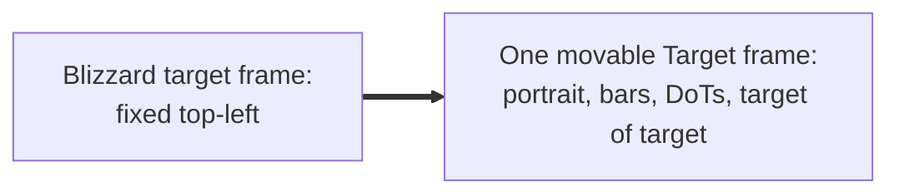
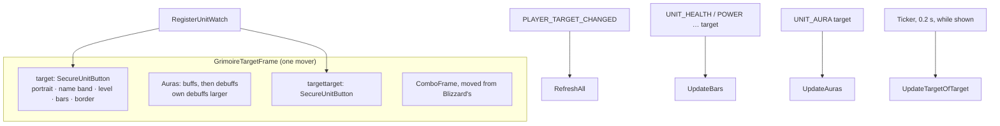

# Target frame

- **Add-on:** `Grimoire_Target` ([`Target.lua`](../../../Grimoire_Target/Target.lua))
- **Module:** `Target`
- **Status:** Scaffolded, untested in game
- **Replaces:** Blizzard's target frame and target-of-target frame; unit-frame add-ons' target frame

## Summary

Your target in Blizzard's classic target frame style: portrait in a ring, name on a band coloured by reaction (red hostile, yellow neutral, green friendly), level coloured by difficulty ("??" for skull level), health and mana, the elite or rare dragon border, raid marker and PvP badge. Below it are the target's buffs and debuffs, with your own debuffs (your DoTs) shown larger and with timers, and a small target-of-target frame. It all sits in one movable "Target" frame, so the parts move together and can't be split up. Left-click targets, right-click opens the target's menu.

## What it solves

## How it works

## Code highlights

**Classification picks the art** ([`Target.lua`](../../../Grimoire_Target/Target.lua)): `UnitClassification` maps `elite`/`worldboss` to `UI-TargetingFrame-Elite`, `rare` to `-Rare`, `rareelite` to `-Rare-Elite`.

**Layout in one table.** Every position (portrait, bars, name band, level circle, auras, target of target, combo points) is in `LAYOUT`, mirrored from Blizzard's classic player frame on the 232×100 art, so a screenshot can be matched by changing numbers in one place.

**Auras are display only.** Plain buttons with icon, stack count, debuff-type border and a cooldown swipe; hovering shows the aura's tooltip. Debuffs you or your pet cast are 21 px instead of 17, like Blizzard's classic frame.

**Target of target is polled.** No event fires when the target's target changes, so it refreshes every 0.2 s while it's shown.

## Design decisions

- **Target auras included** (needed for a Warlock): hiding Blizzard's target frame would otherwise lose your DoTs.
- **Grimoire's own target of target**: Blizzard's is a child of its target frame and stops updating once that's hidden.
- **Combo points are kept** for other classes: `ComboFrame` is moved into the Grimoire frame before Blizzard's is hidden (ADR 0004 rule 4).
- **Tagged mobs** (tapped by someone else) get a grey health bar, as on Blizzard's.
- **Classic look** ([ADR 0001](../../adr/0001-prefer-classic-style-ui.md)): all art is Blizzard's.

## Combat & secret-value constraints

- The target and target-of-target buttons are protected: created and laid out out of combat; they show and hide with their units in combat through unit watches.
- Aura durations that are secret show no swipe; secret health shows raw.

## Settings

Stored in `GrimoireDB.profiles[<profile>].modules.Target`. In the menu: **Components ▸ Target**.

| Key | Default | Menu choices | Description |
| --- | --- | --- | --- |
| `scale` | 1 | Small 0.9 / Normal 1 / Large 1.2 / Huge 1.4 | Frame size |
| `showText` | true | toggle | % on the bars |
| `showAuras` | true | toggle | Buffs and debuffs under the frame |
| `showTargetOfTarget` | true | toggle | The target-of-target frame |
| `hideBlizzard` | true | toggle (needs `/reload` to turn off) | Hide Blizzard's target frame |

## Screenshots

_TODO: add to `screenshots/`. Suggested: an elite with your DoTs, a rare, target of target, move mode._

## Open questions / roadmap

- Verify in game and tune `LAYOUT` from a screenshot: portrait, bars, name band and level circle against the art.
- Does Forever give target aura durations for other players' auras?
- Cast bar on the target frame.
