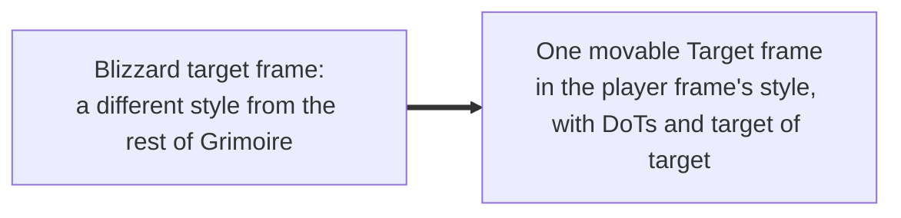
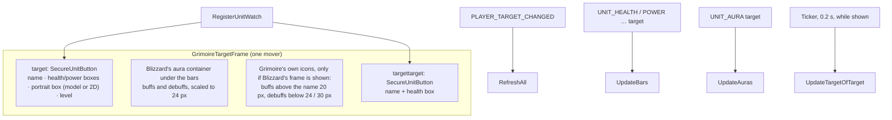

# Target frame

- **Add-on:** `Grimoire_Target` ([`Target.lua`](../../../Grimoire_Target/Target.lua))
- **Module:** `Target`
- **Status:** Scaffolded, untested in game (redesigned 2026-10-13 to match the player frame)
- **Replaces:** Blizzard's target frame and target-of-target frame; unit-frame add-ons' target frame

## Summary

Your target in Grimoire's own style, matching the player frame:
- The name above the bars, in the target's reaction colour (class colour for players), with "(Elite)", "(Rare)" or "(Boss)" after it.
- Bordered health and power bars.
- A square portrait box, animated 3D by default or classic 2D, with the level in its corner coloured by difficulty ("??" for skull level), plus the raid marker and PvP badge.

It's mirrored (bars left, portrait right), so it faces your player frame. Below it are the target's buffs and debuffs, your own debuffs (your DoTs) larger and with timers; beside it, a compact target of target. It all sits in one movable "Target" frame, so the parts move together and can't be split up. Left-click targets, right-click opens the target's menu.

## What it solves

## How it works

## Code highlights

**Events before Blizzard** ([`Target.lua`](../../../Grimoire_Target/Target.lua)). `OnEnable` registers every event first and hides Blizzard's frame last. On Forever, hiding Blizzard's frame once hit a forbidden call, and because it ran first, the frame never registered its events and stayed on its "Target" placeholder.

**Same pieces as the player frame**: bars in classic bordered boxes, the portrait in a `PlayerModel` (or `SetPortraitTexture`), and the shared helpers `UpdateUnitBar`, `UnitLevelText`, `SetUnitRightClickMenu` from [`Core/UnitFrames.lua`](../../../Grimoire/Core/UnitFrames.lua).

**Blizzard's aura container, moved** (`BorrowBlizzardAuras`, `PinAuraContainer`). Blizzard's target frame on Forever draws auras in `TargetFrame:GetAuraContainer()`, whose icons are forbidden frames (`ForbiddenTargetFrameBuffButtonTemplate` / `ForbiddenTargetFrameDebuffButtonTemplate`): add-ons can't list, move or resize them. The container itself is ordinary, so it's reparented under Grimoire's bars, anchored there, and scaled so Blizzard's 17 px icons draw at 24 px. Hooks on its `SetPoint` and `SetParent` pin it back whenever Blizzard re-anchors it. The target frame stays running at alpha 0 (held there by a hook) with the mouse off.

**Auras are display only.** Plain buttons with icon, stack count, debuff-type border and a cooldown swipe; hovering shows the aura's tooltip. Buffs sit above the name in 20 px rows that grow upward; debuffs sit under the bars in 24 px rows that grow downward, and debuffs you or your pet cast are 30 px (Phil, 2026-10-17: enemy debuffs were hard to see). Rows are as wide as the bars.

**Reading auras without tripping secrets.** Forever refuses `GetAuraDataByIndex` on the target while its auras are secret ("Auras cannot be accessed when secret", seen 2026-10-13); the error stopped the whole aura row, so no debuffs showed. `GetAuras` now tries `C_UnitAuras.GetUnitAuras`, then `GetAuraSlots` + `GetAuraDataBySlot`, then by index, then the old `UnitAura`, each call in `pcall`; an empty answer moves on to the next method too (Phil saw no auras at all once, with nothing in the error log), and the module logs which method answered whenever that changes. Fields that may be secret only go to widgets; your own debuffs are found with the `HARMFUL|PLAYER` filter instead of comparing the (secret) caster.

**Target of target is polled.** No event fires when the target's target changes, so it refreshes every 0.2 s while it's shown.

## Design decisions

- **Grimoire style, not Blizzard's classic art** (Phil, 2026-10-13): the first version used Blizzard's classic target texture, which looked too much like the stock frame. It now shares the player frame's look.
- **Mirrored layout**: portrait on the right, facing the player frame. Default position: right of the screen centre, level with the player frame's.
- **Target auras included** (needed for a Warlock): hiding Blizzard's target frame would otherwise lose your DoTs.
- **Grimoire's own target of target**: Blizzard's is inside its target frame and goes with it.
- **Portrait bar style** (Phil's pick from a screenshot, 2026-10-17): one wide bar with the target's 3D model behind a see-through health fill, a thin power strip, and level, name and value on it. The name gives way to the health % once the target is hurt (Phil, 2026-10-17). Auras, raid icon, PvP badge, combo points and target of target move with it. Classic border and bar texture kept ([ADR 0001](../../adr/0001-prefer-classic-style-ui.md)); it's a choice, not the default.
- **Tagged mobs** (tapped by someone else) get a grey health bar.
- **Hidden in place** ([ADR 0007](../../adr/0007-hide-blizzard-frames-in-place.md)): Blizzard's frame isn't reparented, so Edit Mode stays untainted.
- **Blizzard's aura container is borrowed** ([ADR 0008](../../adr/0008-borrow-blizzard-target-auras.md), [ADR 0009](../../adr/0009-move-blizzard-target-aura-container.md), Phil's choice, 2026-10-17): in combat Forever refuses every aura API to add-on code ("Auras cannot be accessed when secret while tainted by 'Grimoire_Target'"), and Blizzard's aura icons are forbidden frames. Moving the whole container is the one thing left. Trade-off: buffs and debuffs are one block under the bars, in Blizzard's order and its debuffs-larger rule; Phil's buffs-above layout only applies to Grimoire's own icons. Blizzard's Edit Mode "Buffs on top" setting for the target frame decides which come first.

## Combat & secret-value constraints

- The target and target-of-target buttons are protected: built and laid out out of combat; they show and hide with their units in combat through unit watches.
- Forever hides real health values (secret values), so the bars show the value the client gives instead of a percentage; secret aura durations use `C_UnitAuras.GetAuraDuration` + `SetCooldownFromDurationObject` where the client has them (no swipe otherwise), secret stack counts use `GetAuraApplicationDisplayCount`, and a secret debuff type gets the default border; a secret level is shown as given.

## Settings

Stored in `GrimoireDB.profiles[<profile>].modules.Target`. In the menu: **Components ▸ Target**.

| Key | Default | Menu choices | Description |
| --- | --- | --- | --- |
| `style` | `animated` | Animated (3D) / Classic (2D) / Portrait bar | Portrait type, or the one-bar Portrait bar look |
| `size` | 64 | Small 48 / Medium 64 / Large 80 | Portrait size (a Portrait bar is four times as wide) |
| `showText` | true | toggle | Show %: health and power as percentages. Portrait bar: the % replaces the name once the target is hurt |
| `showValue` | true | toggle | Show value: health and power as numbers |
| `showAuras` | true | toggle | Target's buffs and debuffs under the frame (Blizzard's container); Grimoire's own icons put buffs above |
| `showTargetOfTarget` | true | toggle | The target-of-target frame |
| `hideBlizzard` | true | toggle (needs `/reload` to turn off) | Hide Blizzard's target frame |

## Screenshots

_TODO: add to `screenshots/`. Suggested: an elite with your DoTs, target of target, move mode._

## Open questions / roadmap

- Secret health %: uses retail's `UnitHealthPercent` with `CurveConstants.ScaleTo100` (and a step curve for the name/% swap) if Forever has them. Untested; without them the raw value shows.
- Cast bar on the target frame.
