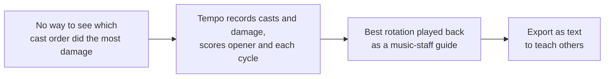
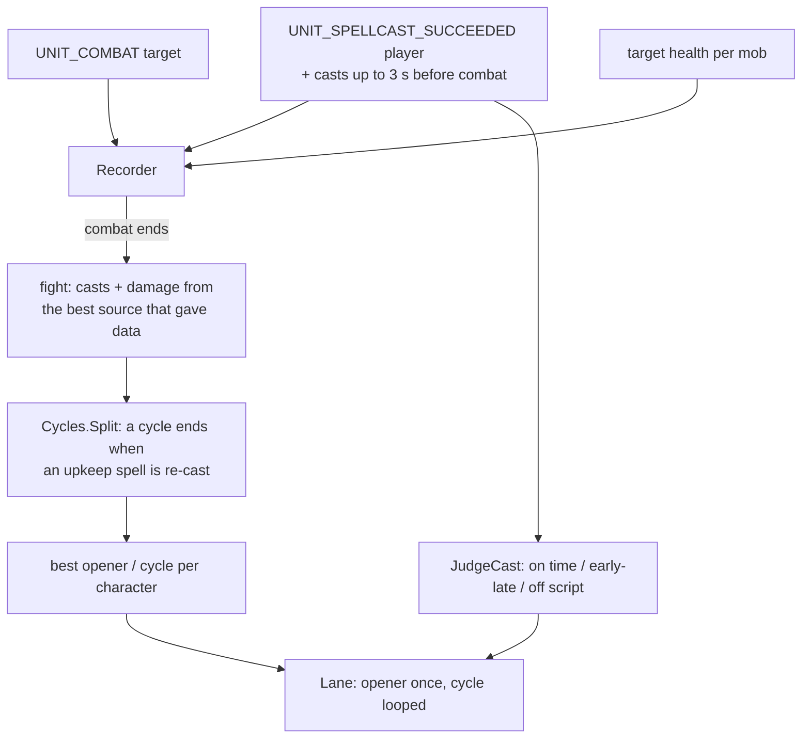

# Tempo

- **Add-on:** `Grimoire_Tempo`
- **Module(s):** `Tempo`
- **Status:** Scaffolded, untested in game (plan milestones T1–T5 of [docs/plans/tempo.md](../../plans/tempo.md))
- **Replaces:** rotation helpers, but as a teaching aid built from your own play rather than a fixed priority list

## Summary

Tempo watches your fights, splits each into an **opener** and repeating **cycles** (the rotation), and scores each one by damage per second. Your best opener and best cycle are played back in later fights on a music-staff lane: spell icons scroll toward a "now" line, and each cast you make lights its note green (on time), yellow (early or late) or leaves it red (missed). You can pin any rotation to practise it, switch to Experiment mode to try something new, and export a rotation as text to teach someone else.

## What it solves

## How it works

- **Cycles.** For a Warlock the upkeep spells are Corruption, Curse of Agony, Immolate, Siphon Life and Curse of Doom: re-casting one that's already in the current cycle starts the next cycle. Other classes have their own list; a class without one uses the fight's first spell.
- **Score.** Damage in the segment divided by its length. Real damage (`dps`) always ranks above the last-resort source, percent of target health per second.
- **Playback.** A matched note re-syncs the music to you, so a slow cast doesn't push every later note out of reach.

## Code highlights

**Analysis without the game** ([`Cycles.lua`](../../../Grimoire_Tempo/Cycles.lua), [`Share.lua`](../../../Grimoire_Tempo/Share.lua)). Plain Lua with no WoW API, loaded by the `.toc` in game and by `lua scripts/tempo/test.lua` on the PC, which checks splitting, scoring, ranks and the share round trip.

**Spells matched by name.** Every rank of a spell has its own ID; matching on the lower-cased name means a rotation survives learning a new rank.

**The pull counts** ([`Recorder.lua`](../../../Grimoire_Tempo/Recorder.lua)). Combat starts when the first spell lands, after it was cast, so casts from the last 3 s before combat are kept and the music starts at the first of them.

**Damage sources tried at once.** `UNIT_COMBAT` and target health both record; the fight keeps the best one that gave data and remembers which (`fight.source`, shown in the window). Secret values are skipped, never compared.

**The probe** ([`Probe.lua`](../../../Grimoire_Tempo/Probe.lua)). `/grim tempo probe` records one fight from every source on its own event frame and saves what each gave (secrets as `<secret>`), plus the client's `C_DamageMeter` and `C_CombatLog` functions.

## Design decisions

- **Casts, not keystrokes.** Add-ons can't record key presses; casts are what a rotation is made of, whether from keybinds, clicks or macros.
- **Guide only.** Tempo never casts anything (the game wouldn't allow it).
- **No combat log.** Forever blocks `COMBAT_LOG_EVENT_UNFILTERED` for add-ons: registering it brought up "Grimoire_Tempo has been blocked from an action only available to the Blizzard UI" (2026-10-16), which `pcall` can't catch. DBM skips it on Forever too. So damage is what your target takes, from anyone: solo fights score exactly, group fights less precisely.
- **Classic look** (ADR 0001): the lane is a classic bordered box with five staff lines and a gold "now" line.
- **Per character** (ADR 0003): fights and bests are saved per character; the window names the character. Imported rotations are account-wide.
- **Text sharing** like Prophecy plans (ADR 0006): readable lines, nothing in them is run.

## Combat & secret-value constraints

Nothing Tempo creates is protected, so it works fully in combat. Secret damage or health values are skipped; if every source is secret, a fight is saved with its casts but no score ("no damage data") and never becomes a best.

## Settings

Stored in `GrimoireDB.profiles[<profile>].modules.Tempo`. In the menu: **Components ▸ Tempo**. Fights and rotations are in `GrimoireTempoDB`.

| Key | Default | Description |
| --- | --- | --- |
| `mode` | `follow` | Playback: Follow my best, Pinned rotation, or Experiment (record only) |
| `showLane` | true | Show the playback lane in combat |
| `keepFights` | 20 | Fights kept per character (10, 20, 50) |

Commands: `/grim tempo` (window), `/grim tempo import`, `/grim tempo probe`.

## Screenshots

_None yet._

## Open questions / roadmap

- Which damage source this client really gives: settled by the probe; the order may change.
- DoT damage that lands after a cycle ends counts toward the next one.
- Classes without DoTs get a crude cycle rule (first spell repeated); better rules later.
