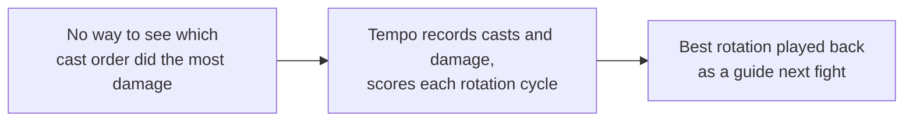
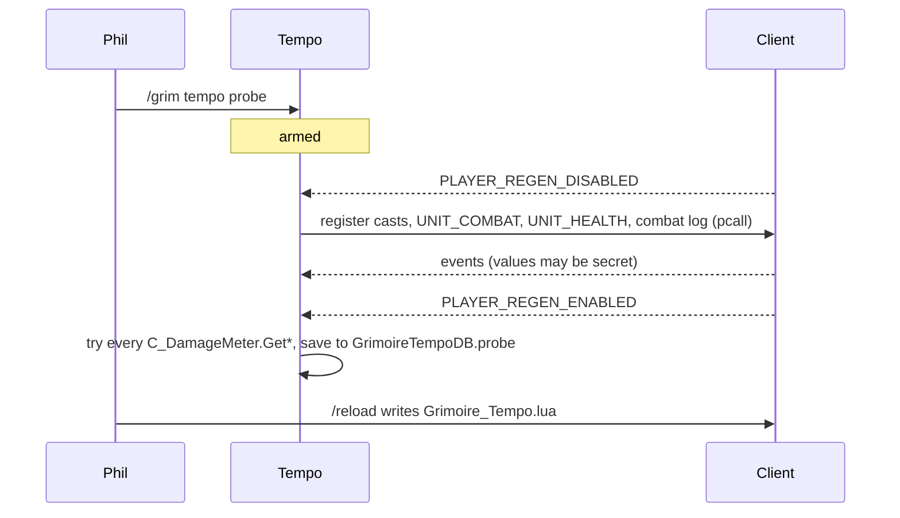

# Tempo

- **Add-on:** `Grimoire_Tempo`
- **Module(s):** `Tempo`
- **Status:** Scaffolded, probe only (milestone T1 of [the plan](../../plans/tempo.md)), untested in game
- **Replaces:** nothing yet; later, rotation helpers such as Hekili-style guides (as a teaching aid, not an auto-advisor)

## Summary

Tempo will learn your best rotation from your own fights and play it back in later fights as a scrolling music-staff guide, so you can repeat it or experiment with variations. Today it has only the probe, which finds out what fight data the client lets an add-on see.

## What it solves

## How it works

The probe (T1):

## Code highlights

**Secrets are never stored.** Every value goes through `Describe` ([`Probe.lua`](../../../Grimoire_Tempo/Probe.lua)), which turns a secret into the text `<secret>`, so the probe shows which values are hidden without comparing or saving them.

**Registering the combat log is itself a test.** It's done in `pcall`; a refusal is saved as the result instead of breaking the probe.

**Capped samples.** Each source keeps at most 40 samples (counts are still complete), so a long fight can't bloat saved data.

## Design decisions

- **Casts, not keystrokes.** Add-ons can't record key presses, and casts are what a rotation is made of anyway (keybinds, clicks and macros all count).
- **Probe first.** The scoring depends on which damage data the client exposes, so that's measured before anything is built on it.

## Combat & secret-value constraints

The probe only listens; it creates no protected frames. Secret values are recorded as `<secret>`.

## Settings

None yet.

## Screenshots

_None yet._

## Open questions / roadmap

See [docs/plans/tempo.md](../../plans/tempo.md): T2 recorder, T3 cycles and scoring, T4 playback lane, T5 sharing.
