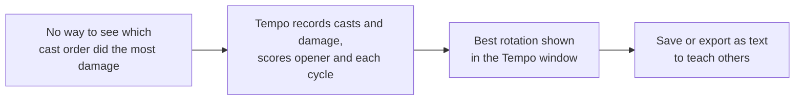
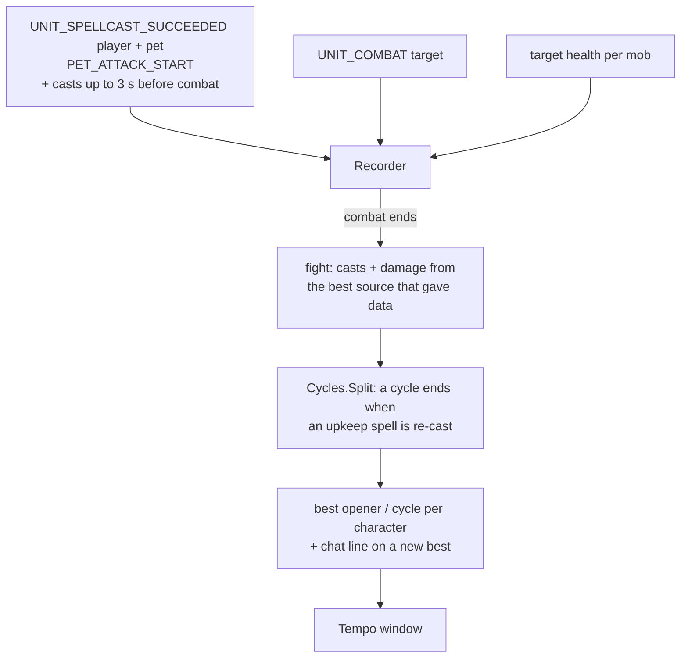

# Tempo

- **Add-on:** `Grimoire_Tempo`
- **Module(s):** `Tempo`
- **Status:** Tested in game (recording, scoring, window); see [docs/plans/tempo.md](../../plans/tempo.md)
- **Replaces:** rotation helpers, but as a teaching aid built from your own play rather than a fixed priority list
- **Opened from:** the floating Tempo button, the [Grimoire menu](../menu/README.md) (*Open ▸ Tempo*), or `/grim tempo`

## Summary

Tempo watches your fights, splits each into an **opener** and repeating **cycles** (the rotation), and scores each one by damage per second. Your best opener and best cycle are kept per character and shown in the Tempo window with their spells in order, next to your recent fights, so you can see what worked. Any rotation can be saved, or exported as text to teach someone else. When a fight sets a new best, chat says so.

## What it solves

## How it works

- **Cycles.** For a Warlock the upkeep spells are Corruption, Curse/Bane of Agony, Immolate, Siphon Life and Curse/Bane of Doom: re-casting one that's already in the current cycle starts the next cycle. Other classes have their own list; a class without one uses the fight's first spell.
- **Score.** Damage in the segment divided by its length. Real damage (`dps`) always ranks above the last-resort source, percent of target health per second.
- **Pets.** Sending your pet in (`PET_ATTACK_START`) is a "Pet Attack" step. Abilities you have your pet use (`UNIT_SPELLCAST_SUCCEEDED` for `pet`) are pet steps, drawn smaller in the window. Abilities the pet casts by itself (autocast on) are left out. Neither kind ever starts a cycle. Pet damage is in every score, since the damage sources measure what the target takes.

## Code highlights

**Analysis without the game** ([`Cycles.lua`](../../../Grimoire_Tempo/Cycles.lua), [`Share.lua`](../../../Grimoire_Tempo/Share.lua)). Plain Lua with no WoW API, loaded by the `.toc` in game and by `lua scripts/tempo/test.lua` on the PC, which checks splitting, scoring, ranks, pets and the share round trip.

**Spells matched by name.** Every rank of a spell has its own ID; matching on the lower-cased name means a rotation survives learning a new rank.

**The pull counts** ([`Recorder.lua`](../../../Grimoire_Tempo/Recorder.lua)). Combat starts when the first spell lands, after it was cast, so casts from the last 3 s before combat are kept.

**Damage sources tried at once.** `UNIT_COMBAT` and target health both record; the fight keeps the best one that gave data and remembers which (`fight.source`, shown in the window). Secret values are skipped, never compared.

**The probe** ([`Probe.lua`](../../../Grimoire_Tempo/Probe.lua)). `/grim tempo probe` records one fight from every source on its own event frame and saves what each gave (secrets as `<secret>`), plus Blizzard's damage meter (`C_DamageMeter`) for every session and meter type.

## Design decisions

- **Casts, not keystrokes.** Add-ons can't record key presses; casts are what a rotation is made of, whether from keybinds, clicks or macros.
- **No combat log.** Forever blocks `COMBAT_LOG_EVENT_UNFILTERED` for add-ons: registering it brought up "Grimoire_Tempo has been blocked from an action only available to the Blizzard UI" (2026-10-16), which `pcall` can't catch. DBM skips it on Forever too. So damage is what your target takes, from anyone: solo fights score exactly, group fights less precisely.
- **No playback lane** (Phil, 2026-10-16: "it's fun but it might just be better to capture rotations in the menu"). A music-staff lane that played your best rotation back in combat was built and removed; rotations are studied in the window instead.
- **Classic look** (ADR 0001) and **per character** (ADR 0003): fights and bests are saved per character; the window names the character. Saved and imported rotations are account-wide.
- **Text sharing** like Prophecy plans (ADR 0006): readable lines, nothing in them is run.

## Combat & secret-value constraints

Nothing Tempo creates is protected, so it records fully in combat. Secret damage or health values are skipped; if every source is secret, a fight is saved with its casts but no score ("no damage data") and never becomes a best.

## Settings

Stored in `GrimoireDB.profiles[<profile>].modules.Tempo`. In the menu: **Components ▸ Tempo**. Fights and rotations are in `GrimoireTempoDB`.

| Key | Default | Description |
| --- | --- | --- |
| `showButton` | true | Show the floating Tempo button (a mover, sized by Layout ▸ Button size) |
| `keepFights` | 20 | Fights kept per character (10, 20, 50) |

Commands: `/grim tempo` (window), `/grim tempo import`, `/grim tempo probe`.

## Screenshots

_None yet._

## Open questions / roadmap

- Blizzard's damage meter may give your own damage (leaving out others in a group); the probe queries it, not run yet.
- DoT damage that lands after a cycle ends counts toward the next one.
- Classes without DoTs get a crude cycle rule (first spell repeated); better rules later.
