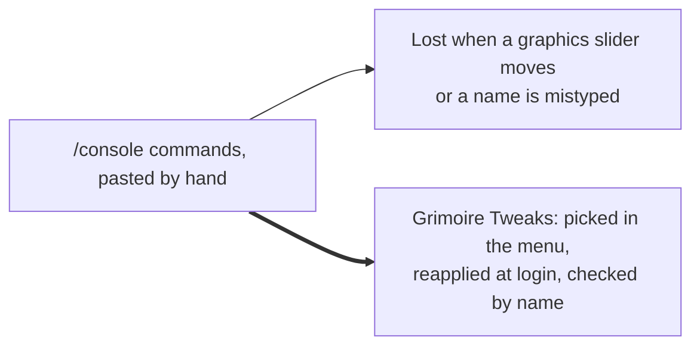
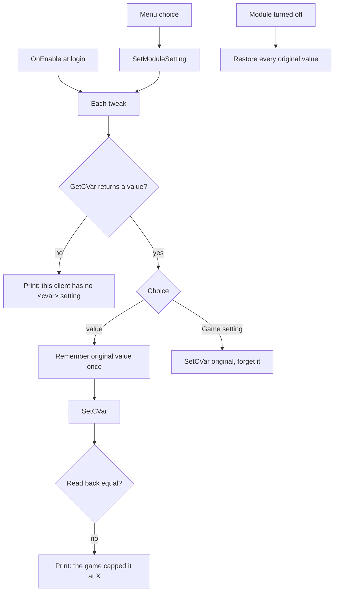

# Tweaks

- **Add-on:** `Grimoire_Tweaks` (`## SavedVariables: GrimoireTweaksDB`)
- **Module:** `Graphics`
- **Status:** Scaffolded, untested in game
- **Replaces:** Pasting `/console` commands; "advanced graphics" add-ons

## Summary

Game settings (CVars) that Blizzard's options menu doesn't offer, or caps lower: a sharper image, denser and longer-range grass, longer terrain detail, the best water reflections and weather, and a longer camera zoom. Each one is a choice in the Grimoire menu, applied at every login. `/grim cvars` saves every setting the client has to a file, to look for more.

## What it solves



Your first try showed both problems: `groundeffectdistance` and `terrainloddistance` aren't real names (the real ones are `groundEffectDist` and `terrainLodDist`), so those two never changed.

## How it works



## Code highlights

**Tweaks are data** ([`Graphics.lua`](../../../Grimoire_Tweaks/Graphics.lua)). Adding one is one line; the menu options and defaults are built from the list:

```lua
{ key = "cameraZoom", cvar = "cameraDistanceMaxZoomFactor", label = "Max camera zoom",
    values = { { "2.6", "2.6" }, { "4", "4" } }, default = "4" },
```

**Undo is built in.** The value a CVar had before Grimoire first touched it is saved in `db.original`, so choosing *Game setting* or turning the module off puts it back.

**The client says what it accepts.** After `SetCVar`, the value is read back; if the client clamped it, you get "the game capped it at X" instead of silently not getting what you asked for.

**`/grim cvars`** walks `C_Console.GetAllCommands()` and saves `name = value (default X) -- help` for every CVar into `GrimoireTweaksDB.cvarDump`. After a `/reload` it's in `WTF\Account\<ACCOUNT>\SavedVariables\Grimoire_Tweaks.lua`, where Claude can read it.

## Design decisions

- **A separate add-on** ([ADR 0002](../../adr/0002-every-component-is-a-toggleable-addon.md)), named *Tweaks* rather than *Graphics* so later non-graphics tweaks (sound, combat) can sit beside `Graphics` as their own modules.
- **Defaults are the values you pasted.** Installing the add-on applies them; pick *Game setting* for any you don't want.
- **Reapplied at login, not continuously.** If you move a graphics slider, Grimoire doesn't fight it during the session; the next login or `/reload` reapplies your choices.
- **Raid settings are separate.** The game has `RAID…` versions of several of these (e.g. `RAIDgroundEffectDist`) used when raid graphics settings are on. They aren't touched yet.

## Combat & secret-value constraints

None of these settings are restricted in combat.

## Settings

Stored in `GrimoireDB.profiles[<profile>].modules.Graphics`. In the menu: **Components ▸ Tweaks**. Every choice also has *Game setting* (leave it alone).

| Key | CVar | Default | Choices |
| --- | --- | --- | --- |
| `sharpen` | `ResampleAlwaysSharpen` | 1 | On |
| `groundDensity` | `groundEffectDensity` | 256 | 128 / 256 |
| `groundDistance` | `groundEffectDist` | 500 | 320 / 500 |
| `terrainDistance` | `terrainLodDist` | 1000 | 650 / 1000 |
| `reflections` | `reflectionMode` | 3 | 3 |
| `weather` | `weatherDensity` | 3 | 3 |
| `cameraZoom` | `cameraDistanceMaxZoomFactor` | 4 | 2.6 / 4 |
| `original` | — | — | Values before Grimoire changed them (internal) |

## Screenshots

_TODO: add to `screenshots/`. Suggested: the Tweaks menu, before/after grass and terrain distance._

## Open questions / roadmap

- Run `/grim cvars` and pick more tweaks from the dump (spell queue window, nameplate distance, error speech, full-screen glow, background FPS, screenshot format).
- Which of these does Forever cap, and at what? The "capped at" messages will tell us.
- Raid (`RAID…`) versions.
