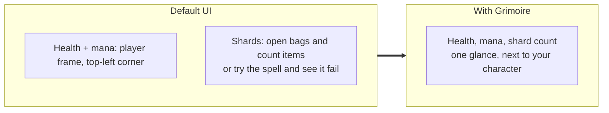
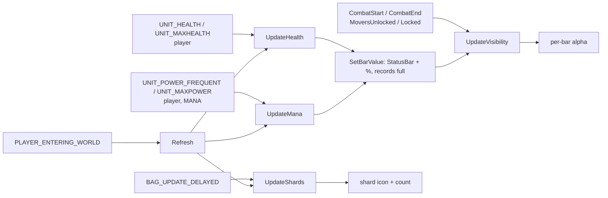
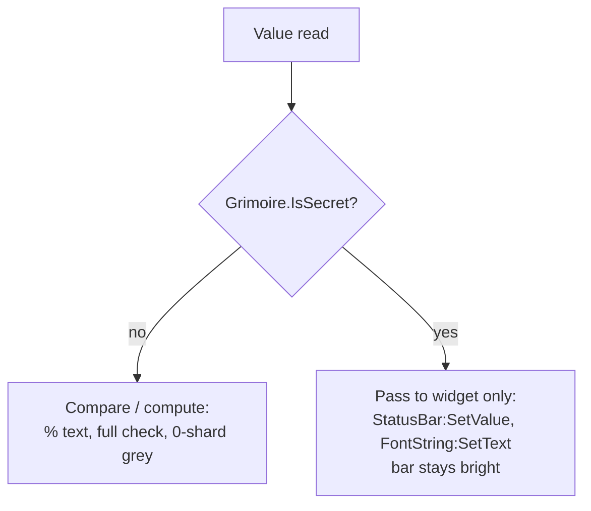

# Warlock resource bar

- **Add-on:** `Grimoire_Warlock` (LoadOnDemand, Warlocks only)
- **Module:** `WarlockResourceBar`
- **Status:** In game testing (loads on Forever 1.60.1)
- **Replaces:** Soul shard counters and player health/mana bar add-ons

## Summary

A compact, movable block near your character: a **health** bar, a **mana** bar below it, and a **soul shard** icon with the count. Soul shards in Forever are bag items, so the default UI only shows them by opening your bags or hovering a spell. This puts health, mana and shards where your eyes already are.

## What it solves



Typical moments where it helps: deciding whether to cast Soulstone/Healthstone/Summon before a pull, noticing shards running out mid-dungeon, and judging health and mana for Life Tap.

## How it works



## Code highlights

**Shards are counted from bags** ([`ResourceBar.lua`](../../../Grimoire_Warlock/ResourceBar.lua)). `BAG_UPDATE_DELAYED` fires once after a batch of bag changes, rather than once per slot:

```lua
local SOUL_SHARD_ITEM = 6265
local count = C_Item.GetItemCount(SOUL_SHARD_ITEM)
```

**Classic look per [ADR 0001](../../adr/0001-prefer-classic-style-ui.md).** Tooltip-style borders, the classic status bar texture, classic green health and classic mana blue (`{0, 0, 1}`), the real Soul Shard icon, and Blizzard fonts.

**Fade only when full.** Each bar fades on its own once it's full and you're out of combat. Anything below full stays bright so it's easy to read while you regen. The shard icon fades only when both bars have:

```lua
local healthDim = not forceShow and self.health.full
self.health.border:SetAlpha(healthDim and dimmed or 1)
```

**Secret-safe text.** If combat makes the values opaque, the bar still fills and the raw number shows instead of a percentage. A secret value can't be compared, so it never counts as full and the bar stays bright:

```lua
local secret = Grimoire.AnySecret(current, max)
bar.full = not secret and current >= max
```

## Design decisions

- **Health above mana**, slightly taller (16 vs 12 px), matching the classic player frame's order.
- **One shard icon plus an exact count**, greyed out at 0. Ten separate icons took space and couldn't show more than ten anyway.
- **Fade when full, not when out of combat.** A bar that's regenerating is information; a full one isn't.
- **Health lives in the Warlock add-on for now.** If other classes get packages, the health/mana bars should move to a shared component and the Warlock add-on keep only shards.

## Combat & secret-value constraints



Forever is a Classic-family client, so secret values may not exist at all; the guards cost nothing if so. None of these frames are protected, so the bars update freely in combat.

## Settings

Stored in `GrimoireDB.profiles[<profile>].modules.WarlockResourceBar`.

| Key | Default | Description |
| --- | --- | --- |
| `width` | 220 | Bar width in pixels |
| `healthHeight` | 16 | Health bar height |
| `manaHeight` | 12 | Mana bar height |
| `barSpacing` | 2 | Gap between bars and the shard row |
| `shardSize` | 26 | Shard icon size |
| `showBarText` | true | Show health/mana % on the bars |
| `alphaWhenFull` | 0.4 | Opacity of a full bar out of combat |
| `manaColor` | `{0, 0, 1}` | Classic mana blue |

## Screenshots

_TODO: add to `screenshots/`. Suggested: full and faded, regenerating (bright), in combat, `/grimoire unlock` overlay, 0 shards._

## Open questions / roadmap

- Verify in game: item ID 6265 and icon lookup.
- Pet frame (health, happiness-style status, current demon).
- Shard capacity awareness via Soul Bag free slots (shared with [Bags](../bags/README.md)).
- Soulstone/Healthstone reminders, out of combat only (decision logic is blocked in combat).
