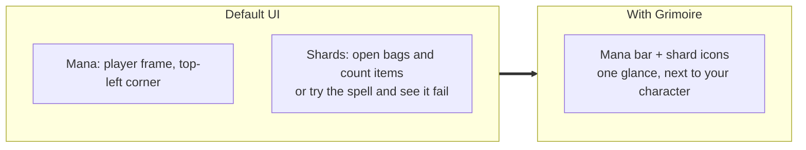
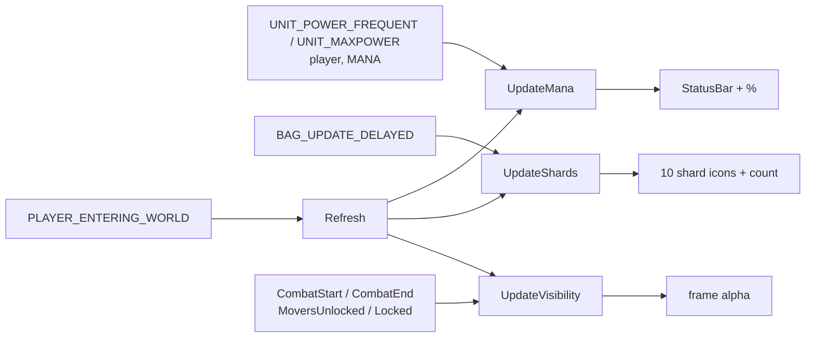
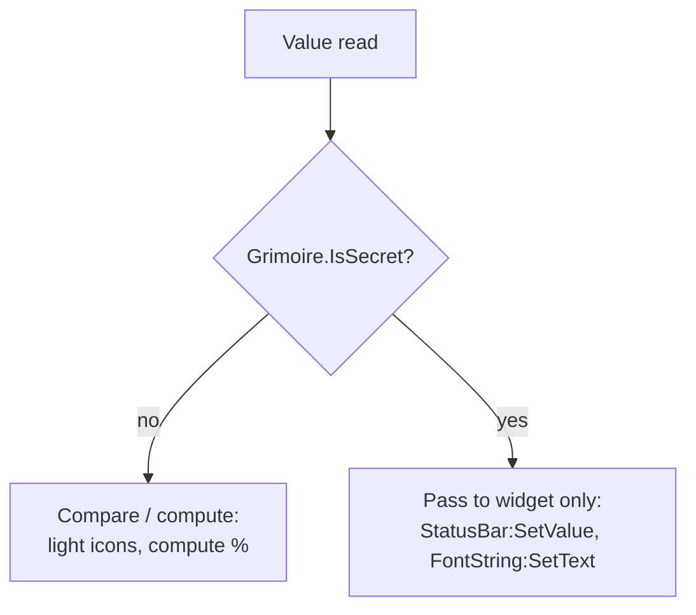

# Warlock resource bar

- **Add-on:** `Grimoire_Warlock` (LoadOnDemand, Warlocks only)
- **Module:** `WarlockResourceBar`
- **Status:** Scaffolded, untested in game
- **Replaces:** Soul shard counters and mana bar add-ons

## Summary

A compact, movable bar near your character showing **mana** and **soul shards**. Soul shards in Forever are bag items, so the default UI only shows them by opening your bags or hovering a spell. This puts the count where your eyes already are.

## What it solves



Typical moments where it helps: deciding whether to cast Soulstone/Healthstone/Summon before a pull, noticing shards running out mid-dungeon, and judging mana for Life Tap.

## How it works



## Code highlights

**Shards are counted from bags** ([`ResourceBar.lua`](../../../Grimoire_Warlock/ResourceBar.lua)). `BAG_UPDATE_DELAYED` fires once after a batch of bag changes, rather than once per slot:

```lua
local SOUL_SHARD_ITEM = 6265
local count = C_Item.GetItemCount(SOUL_SHARD_ITEM)
```

**Classic look per [ADR 0001](../../adr/0001-prefer-classic-style-ui.md).** It uses a tooltip-style border, the classic status bar texture, the real Soul Shard icon, and Blizzard fonts:

```lua
Grimoire.ApplyClassicBackdrop(manaBorder)
mana:SetStatusBarTexture(Grimoire.media.statusbar)
shard:SetTexture(C_Item.GetItemIconByID(SOUL_SHARD_ITEM))
```

**Empty shard slots are desaturated, not hidden**, so you can see your shard capacity at a glance:

```lua
shard:SetDesaturated(not filled)
shard:SetAlpha(filled and 1 or 0.35)
```

**Secret-safe mana text.** If combat makes the values opaque, the bar still fills and the raw number shows instead of a percentage:

```lua
if Grimoire.AnySecret(current, max) then
    bar.text:SetText(current)
else
    bar.text:SetFormattedText("%d%%", math.floor(current / max * 100))
end
```

## Design decisions

- **Icons instead of abstract pips.** Follows ADR 0001 and is instantly recognisable.
- **10 icon slots and an exact count.** Warlocks can carry far more shards than fit on a bar, so icons show "how full" and the number shows "how many".
- **Faded out of combat** (40% alpha) rather than hidden, so it's still glanceable while resting.

## Combat & secret-value constraints



Mana is likely to be secret in combat. Bag item counts probably aren't, but the code guards anyway. Neither frame is protected, so the bar can update freely in combat.

## Settings

Stored in `GrimoireDB.profiles[<profile>].modules.WarlockResourceBar`.

| Key | Default | Description |
| --- | --- | --- |
| `width` | 220 | Bar width in pixels (shard icons scale to fit) |
| `manaHeight` | 12 | Mana bar height |
| `shardSlots` | 10 | Number of shard icons |
| `shardSpacing` | 2 | Gap between icons |
| `showManaText` | true | Show mana % on the bar |
| `alphaInCombat` | 1 | Opacity in combat |
| `alphaOutOfCombat` | 0.4 | Opacity out of combat |
| `manaColor` | `{0, 0, 1}` | Classic mana blue |

## Screenshots

_TODO: add to `screenshots/`. Suggested: out of combat (faded), in combat, `/grimoire unlock` overlay, 0 shards, more than 10 shards._

## Open questions / roadmap

- Verify in game: item ID 6265, icon lookup, and whether mana is secret in combat.
- Pet frame (health, happiness-style status, current demon).
- Shard capacity awareness via Soul Bag free slots (shared with [Bags](../bags/README.md)).
- Soulstone/Healthstone reminders, out of combat only (decision logic is blocked in combat).
