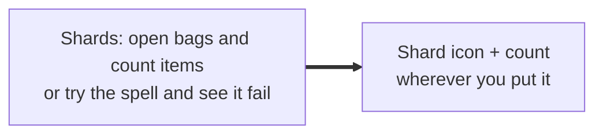
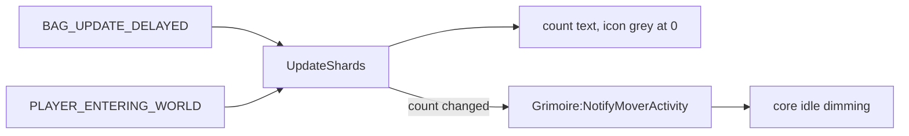

# Warlock resources

- **Add-on:** `Grimoire_Warlock` (LoadOnDemand, Warlocks only)
- **Module:** `WarlockResources`
- **Status:** Scaffolded, untested in game
- **Replaces:** Soul shard counters

## Summary

A soul shard icon with your shard count beside it, movable on its own. Soul shards in Forever are bag items, so the default UI only shows them by opening your bags or hovering a spell. Health and mana are separate frames in [Player bars](../player-bars/README.md); group them in move mode if you want all three to move and dim together.

## What it solves



Typical moments where it helps: deciding whether to cast Soulstone/Healthstone/Summon before a pull, and noticing shards running out mid-dungeon.

## How it works



## Code highlights

**Shards are counted from bags** ([`Resources.lua`](../../../Grimoire_Warlock/Resources.lua)). `BAG_UPDATE_DELAYED` fires once after a batch of bag changes:

```lua
local SOUL_SHARD_ITEM = 6265
local count = C_Item.GetItemCount(SOUL_SHARD_ITEM)
```

**Only real changes count as activity**, so the frame dims once the count settles:

```lua
if count ~= self.lastCount then
    self.lastCount = count
    Grimoire:NotifyMoverActivity("WarlockResources")
end
```

## Design decisions

- **Class resources are their own frame.** Every class package follows the pattern `<Class>Resources`, separate from the shared health/power bars.
- **One icon plus an exact count**, greyed out at 0. The real Soul Shard icon follows [ADR 0001](../../adr/0001-prefer-classic-style-ui.md).
- **Dim when idle is on by default.** Turn it off from the frame's right-click menu in move mode.

## Combat & secret-value constraints

Bag counts probably aren't secret, but if one is, the icon stays lit and the update counts as activity. The frame isn't protected, so it updates freely in combat.

## Settings

Stored in `GrimoireDB.profiles[<profile>].modules.WarlockResources`. Position, group and dimming are mover settings (see [Core](../core/README.md)).

| Key | Default | Description |
| --- | --- | --- |
| `iconSize` | 26 | Shard icon size |

## Screenshots

_TODO: add to `screenshots/`. Suggested: with shards, at 0, grouped with health/mana in move mode._

## Open questions / roadmap

- Verify in game: item ID 6265 and icon lookup.
- Pet frame (health, current demon).
- Soulstone/Healthstone reminders, out of combat only.
